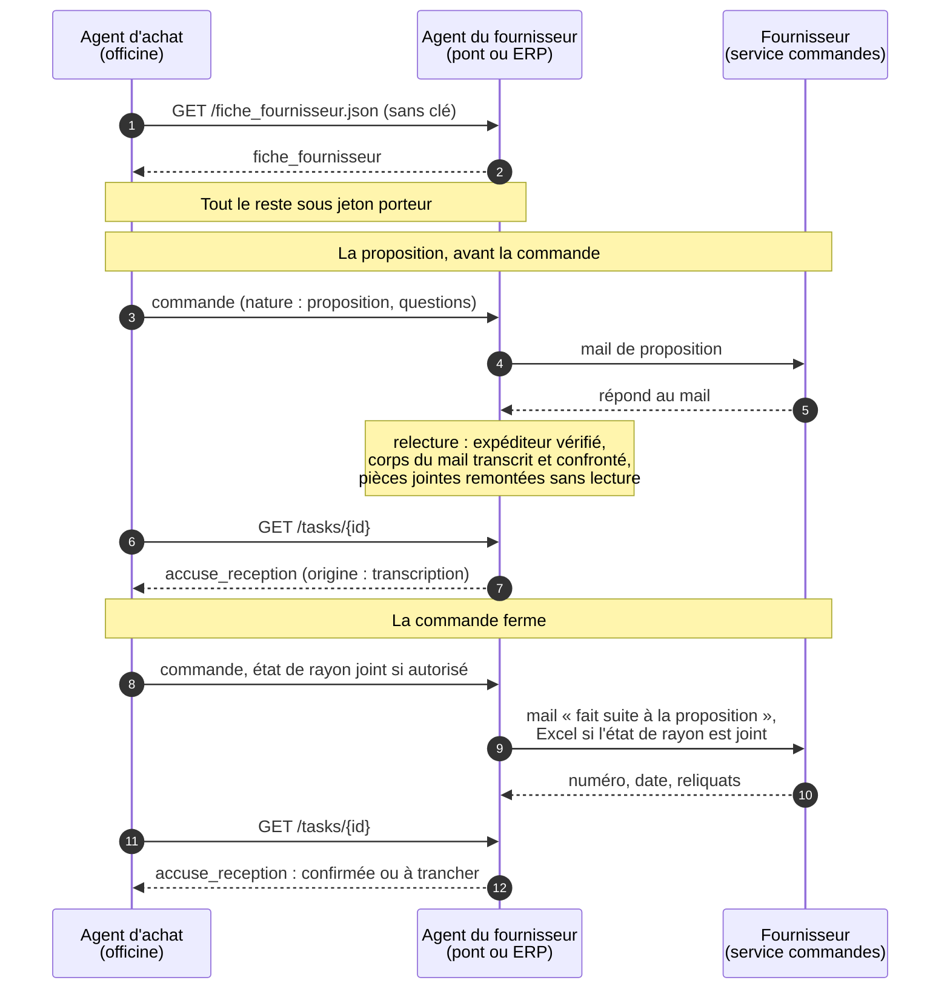
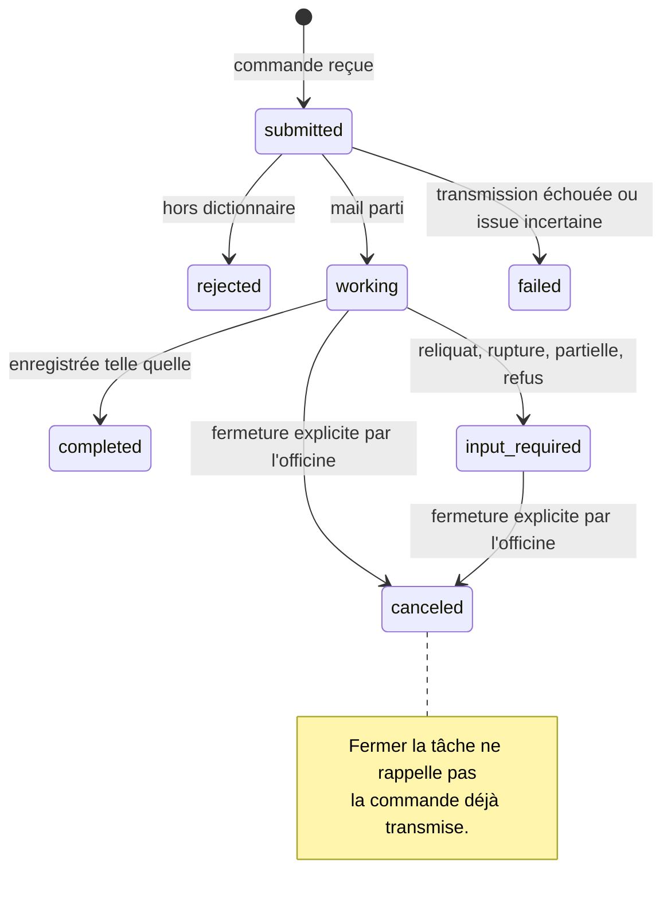

<!-- Ce guide a une version anglaise, docs/guide.md : toute modification se reporte dans les deux. tests/test_guides.py vérifie qu'ils restent jumeaux. -->
# PharmA2A, le guide en français

[Retour au README](../README.md) · [Spécification (en anglais)](../SPECIFICATION.md) · [Les décisions](adr/README.md) · [English version](guide.md)

**Le protocole ouvert de la commande directe entre l'officine et ses fournisseurs, laboratoires, grossistes et plateformes d'achat, posé sur A2A.**

Le dictionnaire (`schema/`) est dans le domaine public, CC0 1.0. L'agent (`pharma2a/`) et
ses tests (`tests/`) sont sous licence Apache 2.0. Chaque dossier porte son fichier LICENSE.
Version 0.1, publiée le 12 novembre 2026.

Ce document s'adresse aux informaticiens des fournisseurs et des éditeurs de logiciels
d'officine.

PharmA2A fixe ce que l'agent d'achat d'une officine et l'agent d'un fournisseur se disent :
la fiche du fournisseur, une commande, une réponse à cette commande, une relance si la
livraison tarde, et, si le pharmacien le décide, l'état de son rayon. Ce dépôt contient le dictionnaire de ces messages et un
agent de fournisseur prêt à l'emploi qui le parle.

## La vision

Aujourd'hui, une commande directe à un fournisseur prend le temps du pharmacien : il compte
son rayon, remplit un bon, l'envoie au délégué, attend une réponse qui arrive par mail ou
par téléphone, puis vérifie à la livraison. Le fournisseur, lui, ne voit la demande qu'au
moment où la commande tombe.

Demain, l'agent d'achat de l'officine prépare chaque commande à partir du rayon réel,
l'envoie quand le pharmacien a dit oui, et lit la réponse. En face, l'agent du fournisseur
la reçoit, la transmet à son service commandes et renvoie ce qu'il confirme, ce qu'il
change et quand il livre. Les deux se parlent en PharmA2A. Les commandes arrivent justes
du premier coup, les écarts remontent seuls, et le fournisseur voit, quand le pharmacien
le veut bien, l'état du rayon de ses produits. Il livre selon la demande réelle au lieu de
la deviner, comme la grande distribution le fait avec ses fournisseurs depuis vingt ans.

Le pharmacien reste maître de ses données et de sa relation avec chaque fournisseur. Rien
ne part sans son geste, aucun de ses prix ne circule, et il coupe le partage quand il veut.
Aucun argent de fournisseur ne finance l'agent de l'officine.

## Les mots

| Mot | Ce qu'il veut dire ici |
|---|---|
| **Agent** | Un logiciel qui agit pour le compte de quelqu'un : il prépare, envoie, lit et relance, au lieu de seulement afficher. |
| **A2A** | Agent2Agent, le protocole ouvert qui permet à deux agents de se parler, publié sous l'égide de la Linux Foundation. C'est le tuyau, il ne sait rien de la pharmacie. |
| **PharmA2A** | Le protocole ouvert de l'échange officine et fournisseur, posé sur A2A. A2A fixe comment on se parle, PharmA2A fixe ce qu'on se dit. |
| **Fournisseur** | Quiconque reçoit une commande directe de l'officine : un laboratoire, un grossiste, une plateforme d'achat. Le dictionnaire dit `fiche_fournisseur` et `fournisseur` ; seul `numero_commande_labo`, dans l'accusé de réception, garde le nom de la première version, écrite pour les laboratoires. |
| **Le dictionnaire** | La forme exacte de chaque message, en JSON Schema, champ par champ, en français. Il est dans le domaine public. |
| **Agent d'achat de l'officine** | L'agent qui prépare et envoie les commandes de l'officine, par exemple celui que SyderaAI fait tourner pour ses officines. N'importe quel éditeur peut écrire le sien. |
| **Agent du fournisseur** | L'agent qui reçoit les commandes PharmA2A pour un fournisseur. Celui de ce dépôt est donné en open source, il ne se vend pas. |
| **La fiche du fournisseur** | Le guichet : qui est le fournisseur, comment on le joint, ses conditions générales, sa gamme par CIP 13 avec colisage et statut, et s'il le veut son tarif catalogue. Elle se lit sans clé, par n'importe quel agent, comme une vitrine ; le tarif, seulement s'il le rend public. Jamais une remise propre à une officine. |
| **La commande** | Le message de l'officine : les produits par code CIP 13, les quantités, la référence. Jamais un prix : l'officine ne dit rien de ses prix. |
| **L'accusé de réception** | La réponse du fournisseur : quantités confirmées, reliquats, ruptures, substitutions, numéro de commande, date de livraison, et s'il les donne son tarif, sa remise et son prix net, ligne par ligne. |
| **L'état de rayon** | Pour les seules références du fournisseur : le stock, les ventes des trois derniers mois, la couverture et les mois finis à zéro. Il ne part que si le pharmacien l'a décidé pour ce fournisseur. |
| **Rupture** | Le fournisseur ne peut pas livrer. Un stock à zéro chez l'officine n'est pas une rupture, c'est « à zéro ». |
| **Le pont** | L'agent du fournisseur hébergé par l'agent d'achat de l'officine, tant que le fournisseur n'a pas le sien. Il écrit au service commandes ou au délégué par mail et relit la réponse. |
| **Le délégué** | Le commercial du fournisseur qui suit l'officine. Avec le pont, c'est souvent lui qui reçoit le mail. |

## Comment on passe d'aujourd'hui à demain

1. **Aujourd'hui, le pont.** Aucun fournisseur n'a encore d'agent. L'agent d'achat de
   l'officine fait tourner celui de ce dépôt pour chaque fournisseur. Le fournisseur reçoit
   un mail clair, la commande dans le corps du mail (et un Excel prêt à saisir quand l'état
   de rayon l'accompagne), et répond comme d'habitude. Rien ne
   lui est demandé.
2. **Demain, l'agent du fournisseur.** Un fournisseur qui veut des commandes propres et la
   visibilité sur le rayon de ses officines fait tourner cet agent lui-même, ou le sien,
   branché sur son système de commandes. L'officine change une adresse, rien d'autre ne
   bouge de son côté.
3. **Ensuite, l'usage commun.** Chaque officine et chaque fournisseur qui parlent PharmA2A
   rendent la ligne plus utile pour tous les autres.

## Ce que contient ce dépôt

| Dossier | Contenu | Licence |
|---|---|---|
| `schema/` | Le dictionnaire : `fiche_fournisseur.json`, `commande.json`, `accuse_reception.json`, `etat_de_rayon.json`, `relance.json`, et un exemple de chaque | CC0 1.0, domaine public |
| `pharma2a/` | L'agent du fournisseur, en Python, sur le SDK officiel `a2a-sdk` | Apache 2.0 |
| `tests/` | Les tests du dictionnaire et de l'agent | Apache 2.0 |

L'agent ne dépend d'aucun éditeur, ne contient aucune adresse et aucun secret.

### Ce qui n'y est pas

Le dépôt dit comment on se parle, pas à qui ni pour qui. Il ne contient ni agent d'achat
d'officine, ni annuaire des agents en service, ni clé, ni donnée d'une officine ou d'un
fournisseur : les noms et les codes des exemples sont fictifs.

La facture passe par les plateformes agréées de la facturation électronique. Le fournisseur
reprend la `reference` de la commande PharmA2A dans le champ référence de commande de sa
facture, et l'`id_ligne` dans le champ référence de ligne de commande.

## Pour l'informaticien du fournisseur

### Les messages

| Message | Sens | Compétence A2A | Où il voyage |
|---|---|---|---|
| `fiche_fournisseur` | fournisseur vers tous | `fiche`, ou `GET /fiche_fournisseur.json` sans clé | artefact de type données, ou le document lui-même |
| `commande` | officine vers fournisseur | `commander` | partie de type données du message envoyé |
| `accuse_reception` | fournisseur vers officine | réponse à `commander` | artefact de type données attaché à la tâche |
| `etat_de_rayon` | officine vers fournisseur | `etat_de_rayon`, ou dans la commande | partie de type données du message envoyé |
| `relance` | officine vers fournisseur | `relancer` | partie de type données du message envoyé |






Six règles qui ne se discutent pas :

1. **Aucun prix de l'officine dans aucun message.** Ce qui appartient à l'officine ne sort
   jamais : ni son prix d'achat moyen, ni son prix de vente, ni sa marge, ni le montant de sa
   commande, ni ses conditions chez un autre fournisseur, ni son canal d'achat (centrale,
   rétrocession), ni un calcul qui mêle ses chiffres à ceux du fournisseur. Ce qui appartient
   au fournisseur circule tel qu'il le donne, jamais recalculé : son tarif catalogue dans sa
   fiche, et dans son accusé de réception, ligne par ligne, son tarif, la remise qu'il
   accorde à cette officine et le prix net qu'il facturera. La commande, elle, ne porte
   aucun prix : la facturation se fait aux conditions en vigueur entre l'officine et le
   fournisseur. Le franco de port est une condition du
   fournisseur : il figure dans un message émis par le fournisseur (`conditions` de
   l'accusé de réception). L'officine peut le rappeler tel quel dans sa commande
   (`franco_ht`), seulement quand son agent a vérifié que la commande l'atteint, et sans
   jamais dire le montant de la commande. De même le colisage d'une ligne (`colisage`), tel
   que le fournisseur l'a donné. Le fournisseur voit ainsi d'un coup d'œil que la commande
   est passée juste, sans avoir à le rappeler. Les schémas refusent tout champ non prévu.
2. **Rien d'inventé.** Un champ que personne n'a dit reste `null`. L'agent ne complète
   jamais une date de livraison, une quantité ou un numéro de commande.
3. **Seul le fournisseur parle pour le fournisseur.** La fiche et l'accusé de réception
   sont ses messages, jamais ceux de l'officine. Une réponse n'est lue que si elle vient
   d'une adresse du domaine à qui la commande a été adressée, et jamais si la boîte de
   réception dit que son expéditeur a échoué à l'authentification (DKIM, SPF, DMARC ; seul
   l'en-tête du serveur de réception de confiance compte, `PHARMA2A_IMAP_AUTHSERV`, et
   `PHARMA2A_EXIGER_AUTHENTIFICATION` écarte ce que la boîte n'a pas vérifié ; il est
   désactivé par défaut pour un premier essai, et conseillé en service : l'adresse
   annoncée par un mail ne prouve pas, seule, qui l'a envoyé). Un
   transfert, une copie ou un message émis depuis l'officine elle-même ne vaut jamais
   réponse, même s'il porte la référence de la commande. Un accusé doit répondre à la
   commande qu'il nomme : même référence, des id_ligne qui existent dans la commande et ne se
   répètent pas, des codes qui sont ceux de la ligne désignée et rien de plus ; sinon il
   est écarté. Une
   fiche ne contient que ce que le fournisseur a dit lui-même, dans son tarif, ses
   conditions ou la réponse de son délégué.
4. **Un message qui ne dit rien n'est pas une confirmation.** Sans ligne, sans numéro de
   commande, sans date de livraison et sans condition, la réponse est ignorée et la tâche
   reste en cours.
5. **L'officine appelle, le fournisseur répond.** Pas de notification entrante, pas de
   flux. L'officine relit la tâche quand elle le veut.
6. **Aucune donnée de patient.** Ni nom, ni ordonnance, ni numéro de sécurité sociale. Le
   protocole parle de produits, de quantités et de stocks, jamais de personnes.

**Une commande n'est transmise qu'une fois.** La référence (`reference`) est
l'identité de la commande, unique par officine. La même référence reçue une seconde fois
de la même officine (même compte client, même CIP, ou même nom à la même adresse), par
exemple quand l'agent de l'officine renvoie après une coupure réseau, rend la tâche déjà
ouverte, même identifiant, même état, et rien ne repart. Une retransmission ne doit jamais produire une seconde commande commerciale. La
proposition et la commande qui la suit partagent la référence mais pas la nature : ce
sont deux tâches. Une tâche refusée, échouée ou annulée n'a rien transmis : sa référence
peut revenir ; après une fermeture par l'officine, le mail dit qu'il annule et remplace
l'envoi précédent sous cette référence ; après un échec du canal, dont on ne sait pas si
le mail est parti, il dit que s'il est arrivé, celui-ci le remplace ; la commande ferme
qui suit une proposition dit qu'elle lui fait suite. La même référence avec un autre
contenu (produits, quantités, colisages, adresse de livraison, date exigée, reliquat
accepté) pendant que la tâche est encore ouverte n'est pas une répétition : elle est refusée, avec le geste à faire (fermer la tâche, puis renvoyer).
Ainsi une relance ou une correction ne reste jamais sans partir en silence. Un message posé sur une tâche déjà ouverte, avec
son identifiant, ne transmet rien non plus : la tâche reste dans son état et le dit.
Une ligne par produit : le même code (CIP, EAN ou référence) sur deux lignes est refusé.
Chaque ligne porte un `id_ligne`, unique dans la commande, et l'accusé de réception répond
ligne par ligne avec cet identifiant.

**Les noms de champs sont en français, c'est voulu.** Le dictionnaire décrit l'officine
française (CIP 13, franco, reliquat, colisage), et traduire ses mots les rendrait flous.
*Field names are in French, on purpose: the dictionary describes French pharmacy practice,
and translating its words would blur them.*

### `fiche_fournisseur` : le guichet du fournisseur

Avant toute commande, un agent veut savoir à qui il parle : la fiche le dit. Qui est le
fournisseur, le service commandes et les délégués par département, le franco et sur quelle
assiette il se compte, le délai, les jours d'expédition, et la gamme : chaque référence en
direct avec son colisage et son statut (`actif`, `nouveau`, `arrete` avec la référence qui
remplace, `sur_commande` avec son délai). Comme dans la commande, une référence porte son
`cip13`, son `ean13` ou sa `ref_fournisseur`, au moins un des trois. Le fournisseur peut y
publier son **tarif catalogue** : le prix HT de l'unité avant remise (`prix_tarif_ht`) sur
chaque ligne, daté dans `tarif`, le même pour toutes les officines, avec le taux de TVA de
la référence (`taux_tva`), que la vitrine montre même sans le tarif. Jamais une remise ni un
prix propre à une officine. La version complète du tarif et les conditions générales de
vente restent des documents, référencés par leur adresse dans `documents`.

La fiche se lit **sans clé**, sur `GET /fiche_fournisseur.json` à côté de la carte : c'est
une vitrine, n'importe quel agent peut la consulter, même celui d'une officine qui n'est pas
encore cliente. Par A2A, un message portant `{"version": "1", "demande": "fiche_fournisseur"}`
la rend en artefact. Sans clé, la vitrine ne montre pas le tarif (ni le bloc, ni les prix des
références, ni le document de nature `tarif`), sauf si le fournisseur le rend public
(`PHARMA2A_FICHE_TARIF_PUBLIC=1`) ; l'officine authentifiée le reçoit toujours. Une fiche non
conforme n'est pas servie : la vitrine répond 503 sans le détail, qui reste dans le journal.
Une condition particulière à une officine (sa remise) n'y entre jamais : elle voyage dans
l'accusé de réception, sous clé.

```json
{
  "version": "1",
  "fournisseur": { "nom": "LABORATOIRE EXEMPLE", "siren": "000000000", "site": "https://www.laboratoire-exemple.example", "marques": ["EXEMPLE"] },
  "date": "2026-10-30",
  "contacts": {
    "commandes": { "email": "commandes@laboratoire-exemple.example", "telephone": "01 00 00 00 00", "horaires": "du lundi au vendredi, 9 h à 17 h" },
    "delegues": [ { "secteur": ["75", "92", "94"], "email": "secteur-ouest@laboratoire-exemple.example", "telephone": "06 00 00 00 00" } ]
  },
  "conditions": { "franco_ht": 400, "assiette_franco": "net_remise", "delai_livraison_jours": 3, "jours_expedition": ["mardi", "jeudi"], "commande_directe": true, "par_grossiste": true },
  "tarif": { "date": "2026-01-01", "devise": "EUR" },
  "gamme": [
    { "cip13": "3400000000011", "libelle": "PROBIOTIQUE 7 SOUCHES STICKS 30", "colisage": 6, "prix_tarif_ht": 9.90, "taux_tva": 5.5, "statut": "actif" },
    { "cip13": "3400000000035", "libelle": "EQUILIBRE FEMININ GELULES 15", "statut": "arrete", "date_arret": "2026-10-01", "cip13_remplace_par": "3400000000042" },
    { "cip13": "3400000000059", "libelle": "CHEVEUX ET ONGLES GELULES 60", "statut": "sur_commande", "delai_jours": 15 }
  ],
  "documents": [ { "nature": "tarif", "url": "https://www.laboratoire-exemple.example/pro/tarif-2026.pdf", "date": "2026-01-01" } ]
}
```

L'assiette du franco se dit ou reste `null` : un franco donné sans assiette n'autorise
l'agent de l'officine à rien déduire. La fiche est un message du fournisseur (règle 3) :
avec le pont, elle ne reprend que ce que le fournisseur a dit, son tarif, ses conditions,
les réponses de son délégué, transcrits sans rien ajouter ; rien n'y vient de l'officine.
Le jour où le fournisseur sert son propre agent, il publie la sienne.

### `commande` : ce que le fournisseur reçoit

Un bon de commande : l'officine, une référence, une date, des lignes. Chaque ligne porte son
`id_ligne`, le code du produit, un libellé indicatif et une quantité en unités de vente. Le
code est d'abord le CIP 13 ; certains produits de parapharmacie n'en ont pas, la ligne porte
alors son `ean13` ou sa `ref_fournisseur`, au moins un des trois. Le champ facultatif
`agent` dit quel agent écrit et quel pharmacien a validé. Le champ facultatif
`etat_de_rayon` joint l'état de rayon à la commande, pour un seul envoi.

Deux champs facultatifs disent ce que l'officine attend de la réponse :

- `date_livraison_exigee` : à `true`, une confirmation sans date de livraison ferme n'en est
  pas une, le pharmacien tranche ;
- `reliquat_accepte` : à `true`, ce qui ne part pas tout de suite peut suivre en reliquat
  sans nouvelle commande, et un reliquat ne demande rien au pharmacien ; à `false`, ce qui
  ne part pas est annulé. Une ligne peut dire autre chose que la commande, son propre
  `reliquat_accepte` prime. Absent : l'officine n'a rien dit, un reliquat se tranche.

Le mail du pont le dit au fournisseur en clair, sous le tableau.

```json
{
  "version": "1",
  "reference": "BC-26018-EXEMPLE",
  "date": "2026-10-15",
  "officine": {
    "nom": "Pharmacie de l'Exemple",
    "numero_compte_client": "123456",
    "cip_officine": "2000001",
    "telephone": "02 00 00 00 00",
    "adresse_livraison": { "ligne1": "1 rue de la Pharmacie", "ligne2": null, "code_postal": "75001", "ville": "Paris", "pays": "FR" }
  },
  "lignes": [
    { "id_ligne": "1", "cip13": "3400000000011", "libelle": "PROBIOTIQUE 7 SOUCHES STICKS 30", "quantite": 6 },
    { "id_ligne": "2", "cip13": "3400000000028", "libelle": "PROBIOTIQUE DIGESTION GELULES 20", "quantite": 21 },
    { "id_ligne": "3", "ean13": "3600000000017", "libelle": "BROSSE A DENTS SOUPLE", "quantite": 12 }
  ],
  "message": null,
  "agent": { "nom": "Agent Exemple", "signataire": "Dr Exemple" }
}
```

### La proposition : la commande avant la commande

Quand l'agent de l'officine ne connaît pas encore les conditions du fournisseur, il envoie
d'abord sa commande comme une **proposition** (`"nature": "proposition"`), avec ses
**questions** (`"questions": ["franco", "colisage", "delai_livraison", "catalogue"]`). Le
fournisseur ne l'expédie pas : il la confirme et répond. L'agent corrige la commande avec la
réponse, le pharmacien la valide, et la commande définitive part ensuite, sous la même
référence. Le mail du pont le dit en clair et liste les questions.

### `accuse_reception` : ce que le fournisseur renvoie

La réponse ligne par ligne, chaque ligne retrouvée par son `id_ligne` : quantité confirmée,
reliquat, rupture, substitution proposée, commentaire, et les conditions du fournisseur pour
cette officine s'il les donne : son tarif (`prix_tarif_ht`), sa remise (`remise_pct`) et le
prix net qu'il facturera (`prix_net_ht`) et le taux de TVA (`taux_tva`), chacun tel qu'il l'écrit, jamais calculé à partir
des autres. Une remise valable pour toute la commande se dit une fois, au niveau de
l'accusé (`remise_pct`) ; celle d'une ligne l'emporte. La remise est celle qui figure sur la
facture : une remise de fin d'année ou un accord arrière n'y entrent pas. Plus le numéro donné à la commande et la date de livraison prévue. Un prix net
qui change dans un second mail revient au pharmacien. Et d'où vient l'accusé, `origine` : `erp` quand un système du
fournisseur l'a produit, `transcription` quand un agent a lu une réponse humaine (un mail, un
PDF) et l'a transcrite. Une transcription peut se tromper : l'agent de l'officine ne doit
jamais la prendre pour une confirmation automatique, elle remonte au pharmacien.

```json
{
  "version": "1",
  "reference": "BC-26018-EXEMPLE",
  "origine": "erp",
  "numero_commande_labo": "SO-884512",
  "date_livraison_prevue": "2026-10-20",
  "lignes": [
    { "id_ligne": "1", "cip13": "3400000000011", "quantite_confirmee": 6, "prix_tarif_ht": 9.90, "remise_pct": 30, "prix_net_ht": 6.93, "taux_tva": 5.5, "reliquat": 0, "rupture": false, "cip13_substitue": null, "commentaire": null },
    { "id_ligne": "2", "cip13": "3400000000028", "quantite_confirmee": 12, "prix_tarif_ht": 7.50, "remise_pct": 30, "prix_net_ht": 5.25, "taux_tva": 5.5, "reliquat": 9, "rupture": false, "cip13_substitue": null, "commentaire": "9 en reliquat, départ semaine 44" },
    { "id_ligne": "3", "ean13": "3600000000017", "quantite_confirmee": 0, "rupture": true, "commentaire": "rupture fabricant, retour prévu en décembre" }
  ],
  "commentaire": "Commande enregistrée le 15/10, départ le 17/10."
}
```

Deux champs répondent à une proposition : `colisage` sur chaque ligne, quand le fournisseur
vend par plusieurs, et `conditions` pour la commande entière (`franco_ht`,
`delai_livraison_jours`, `catalogue_joint`). Un catalogue joint au mail remonte tel quel dans
l'artefact `pieces_jointes` de la tâche.

Si tout est confirmé tel que commandé, la tâche est terminée. S'il y a un reliquat, une
rupture, une substitution ou une quantité changée, la tâche passe en `input-required` et
le pharmacien tranche lui-même. Une commande ferme répondue sans confirmation, un colisage,
une condition ou un catalogue seulement, passe aussi en `input-required` : le fournisseur a
parlé, il n'a pas confirmé. De même une réponse partielle : sans numéro de commande ni date
de livraison, une ligne confirmée ne confirme pas les autres, qui restent inconnues. Un
numéro de commande ou une date de livraison, eux, disent que le fournisseur a enregistré la
commande : les lignes qu'il ne commente pas sont réputées telles que commandées, il ne
liste que les exceptions, comme sur tout accusé de réception. Le fournisseur peut aussi le
dire en toutes lettres : `confirmation_globale` à `true` (« commande confirmée telle
quelle »), ou à `false` s'il ne prend pas la commande, et le pharmacien tranche. Un
reliquat à zéro seul ne répond à rien. Pour
une proposition, cette même réponse est celle qu'on attendait, et la tâche est terminée.
Rien n'est accepté automatiquement.

**Le fournisseur peut écrire une seconde fois.** Une tâche répondue reste à l'écoute
30 jours : un nouveau mail sur la même commande est lu avec les mêmes contrôles. S'il
change quelque chose (une rupture, une quantité, une date de livraison décalée, un refus,
un prix net ou une remise),
le pharmacien tranche (`input-required`) ; s'il ne fait que compléter (une date ou un numéro
qui manquaient), l'état reste ; s'il ne dit rien de neuf, rien ne bouge. Une tâche en
`input-required` reçoit le nouvel `accuse_reception` à la suite du premier. Chaque mail se
compare à tout ce que les précédents ont dit (la date du premier, le numéro du second), et
un même mail n'est jamais traité deux fois. Une tâche
`completed` ne se rouvre jamais, comme A2A le veut : le pont ouvre une **tâche de suite**
dans le même `contextId`, qui nomme la première (métadonnée `suite_de`, et
`referenceTaskIds` dans son premier message), porte le nouvel accusé et écoute à sa place.
L'agent de l'officine suit la chaîne et lit le dernier accusé. Une tâche fermée par
l'officine n'écoute plus, et une suite fermée ferme tout le fil.

`input-required` est le dernier mot du pont sur cet échange, en version 0.1 : le pharmacien
tranche dans son propre agent, et répond au fournisseur par mail, par téléphone ou par une
nouvelle commande sous une nouvelle référence. Un message posé sur la tâche ne transmet
rien. L'officine ferme la tâche quand elle a tranché (`tasks/{id}:cancel`) ; fermer ne
rappelle pas un mail parti.

### `relance` : quand la livraison tarde ou que la réponse manque

L'officine relance une commande déjà transmise, sous la même référence. Deux motifs :
`livraison_en_retard` (avec `date_livraison_annoncee`, la date que le fournisseur avait
donnée) et `sans_reponse`. L'agent retrouve la commande qu'il a reçue sous cette référence
pour la même officine, et refuse la relance s'il n'en trouve pas. Une seule relance par
motif et par jour.

Le pont écrit au fournisseur dans le fil de la commande (`In-Reply-To`), rappelle la
référence, la date annoncée et les lignes commandées, et demande où en est la commande. Une
relance ne passe jamais de nouvelle commande et ne change ni les produits ni les quantités.
La réponse du fournisseur revient sur la tâche de la relance, en `accuse_reception`, avec
les mêmes contrôles qu'une réponse à la commande : la nouvelle date de livraison, une
rupture, un refus.

```json
{
  "version": "1",
  "reference": "BC-26018-EXEMPLE",
  "date": "2026-11-02",
  "officine": { "nom": "Pharmacie de l'Exemple", "numero_compte_client": "123456", "adresse_livraison": { "ligne1": "1 rue de la Pharmacie", "ligne2": null, "code_postal": "75001", "ville": "Paris", "pays": "FR" } },
  "motif": "livraison_en_retard",
  "date_livraison_annoncee": "2026-10-30",
  "message": null
}
```

### `etat_de_rayon` : ce que le fournisseur reçoit, si le pharmacien l'a décidé

Le pharmacien allume le partage fournisseur par fournisseur, sur les seules références de
ce fournisseur, et l'éteint quand il veut. Aucun prix, aucune marge, aucun chiffre
d'affaires, aucune référence d'un autre fournisseur, aucune donnée patient. L'agent refuse
un état de rayon qui ne serait pas celui de l'officine de la commande, ou qui nommerait un
autre fournisseur que le sien.

```json
{
  "version": "1",
  "officine": { "nom": "Pharmacie de l'Exemple", "numero_compte_client": "123456", "cip_officine": "2000001" },
  "fournisseur": "LABO UN",
  "date": "2026-10-15",
  "periode": { "du": "2026-07-01", "au": "2026-09-30" },
  "lignes": [
    { "cip13": "3400000000011", "libelle": "PROBIOTIQUE 7 SOUCHES STICKS 30", "stock": 0, "ventes_3_mois": 2, "couverture_jours": 0, "mois_a_zero_3_mois": 1 },
    { "cip13": "3400000000028", "libelle": "PROBIOTIQUE DIGESTION GELULES 20", "stock": 3, "ventes_3_mois": 12, "couverture_jours": 23, "mois_a_zero_3_mois": 0 },
    { "cip13": "3400000000059", "libelle": "CHEVEUX ET ONGLES GELULES 60", "stock": 0, "ventes_3_mois": 0, "couverture_jours": null, "mois_a_zero_3_mois": 3 }
  ]
}
```

On compte en mois finis à zéro et pas en jours, parce que le logiciel de l'officine ne
garde pas l'historique quotidien de son stock. Un compte de jours serait inventé.

Le champ facultatif `accord` dit ce que le pharmacien autorise : `usage` à `livraison`
(uniquement pour mieux livrer cette officine) ou `previsions` (aussi pour les prévisions
globales du fournisseur, sans jamais en céder les données), `valable_jusqu_au` (une date,
ou `null` jusqu'à ce qu'il le retire), `frequence` (`commande`, `quotidienne`,
`hebdomadaire`, `mensuelle`). Sans `accord`, le fournisseur s'en tient à mieux livrer.

## Le pont, concrètement

Quand l'agent tourne en pont, il écrit au fournisseur par mail.

- **Un seul mail par commande.** Le tableau de la commande est dans le corps du mail, avec
  le stock et les ventes de chaque ligne quand l'état de rayon est partagé. Dans ce cas, un
  fichier Excel est joint, avec un onglet « Commande » prêt à saisir et un onglet « État de
  rayon ».
- **Le mail se présente.** Il dit quel agent écrit, pour quelle officine, et quel
  pharmacien a validé. Il porte un en-tête `X-PharmA2A-Reference`.
- **La réponse revient seule.** Le délégué répond au mail comme d'habitude. L'agent relit
  la boîte de réponse à intervalle régulier. Un mail qui ne vient pas du domaine du
  destinataire de la commande est écarté avant toute lecture (règle 3). Les autres sont
  transcrits en `accuse_reception`, avec `origine` à `transcription`,
  par un modèle de langage qui n'a aucun outil et ne reçoit le texte qu'entre guillemets,
  valide le résultat contre le dictionnaire, et l'attache à la tâche. Ce qui n'est pas
  écrit dans la réponse reste `null`. Si la transcription ne respecte pas le dictionnaire,
  ou si elle ne dit rien sur la commande (règle 4), la tâche reste en cours et rien n'est
  inventé. Un mail n'est marqué lu qu'une fois traité ou écarté pour de bon : si le modèle
  est injoignable, la réponse attend la passe suivante dans la boîte. La réponse retrouve
  sa commande d'abord par le `Message-ID` du mail envoyé, qu'elle cite dans son
  `In-Reply-To` (puis dans son fil `References`), sinon par la référence dans l'objet ou le
  texte, parmi les commandes en cours dont l'expéditeur est le fournisseur. Une réponse qui
  cite un envoi dont la tâche est fermée répond à cet envoi-là : elle est écartée, elle ne
  se rattache pas au suivant sous la même référence. Deux tâches en cours qui peuvent toutes
  deux la recevoir rendent une réponse ambiguë : elle attend aussi.
- **Ce que le modèle voit.** La transcription est la seule étape qui sort de l'agent. Le
  prestataire du modèle (`PHARMA2A_MODELE`) reçoit le texte de la réponse du délégué et, pour
  la rattacher, la référence de la commande et ses lignes (codes produit, libellés, quantités).
  L'agent n'y ajoute jamais l'identité de l'officine (nom, compte, adresse), ni la boîte
  mail, ni les autres commandes, ni aucun prix : la commande n'en porte pas. Ce que le délégué
  a lui-même écrit dans sa réponse part tel quel. Sans modèle configuré, rien ne part :
  les réponses attendent dans la boîte, à transcrire autrement (par un ERP, ou à la main).
- **Brouillon par défaut.** Tant que `PHARMA2A_BROUILLON` vaut 1, rien ne part : chaque
  mail s'écrit dans le dossier `sorties/` pour être relu.

## Le protocole

- **A2A 1.0** (texte 1.0.1), liaison HTTP+JSON (`POST /message:send`, `GET /tasks/{id}`) et
  JSON-RPC sur la même racine. Les deux sont déclarées dans la carte. L'en-tête
  `A2A-Version: 1.0` est attendu : la version se compare en majeure et mineure (`1.0.1` passe,
  `1.1` ou `1.999` sont refusées par `VersionNotSupportedError`).
- **La liste des tâches** (`GET /tasks`) ne rend, ne compte et ne pagine que les tâches du
  compte du jeton : `totalSize` ne dit rien des autres officines.
- **Carte d'agent** sur `/.well-known/agent-card.json` : nom, description, adresse du
  fournisseur (`provider.url`), interfaces, sécurité et compétences, publiques, comme le
  texte d'A2A 1.0 le demande. La carte étendue, identique, reste servie aux clients
  authentifiés.
- **Authentification** par jeton porteur, que le fournisseur délivre à chaque officine et
  rattache à son numéro de compte client (voir [Les jetons des officines](#les-jetons-des-officines)).
- **Capacités** : `streaming: false`, `pushNotifications: false` Une demande de flux reçoit
  `UnsupportedOperationError`.
- **Extension** : PharmA2A se déclare dans la carte comme une extension de profil d'A2A
  (`capabilities.extensions`, adresse `https://pharma2a.org/ext/v1`, la version 1 du
  dictionnaire ; un changement qui casse fera une nouvelle adresse). Elle est facultative
  (`required: false`) : un client qui ne la demande pas par l'en-tête `A2A-Extensions` est
  servi pareil, puisque chaque message est de toute façon validé contre le dictionnaire. Les
  artefacts qui portent un message du dictionnaire (accusé, fiche) la citent dans leurs
  `extensions`.
- **Cycle d'une commande** : `submitted` à la réception et à la validation, `working` quand
  la commande est partie chez le fournisseur, `completed` avec l'accusé en artefact quand
  la réponse confirme tout, `input-required` quand le pharmacien doit trancher, `rejected`
  quand le message ne respecte pas le dictionnaire, avec le motif dans le message d'état.
  Un envoi rend la main quand l'agent a fini son tour, la commande partie, en `working` :
  la réponse du fournisseur vient des heures ou des jours plus tard, l'officine relit la
  tâche. `returnImmediately` rend la tâche dès sa création. Une commande renvoyée à
  l'identique rend la tâche déjà ouverte, avec la limite `historyLength` demandée.
- **Écart connu avec A2A.** Avec `returnImmediately` à `false` (la valeur par défaut), le
  texte demande d'attendre un état terminal ou interrompu avant de répondre. Une commande ne
  l'atteint que quand le fournisseur répond, parfois des jours plus tard : aucune connexion
  ne tient aussi longtemps. Le pont répond donc dès que la commande est partie, en
  `working`, et le dit dans le message d'état. Le client relit la tâche (`GET /tasks/{id}`)
  ou envoie `returnImmediately: true`.
- **Un processus par magasin** : les tâches d'un magasin sont servies par un seul processus,
  qui tient le verrou d'idempotence. Plusieurs agents, c'est l'annuaire, pas plusieurs
  processus sur le même fichier.
- **Entiers** : le transport A2A peut rendre un entier en flottant, `6` devient `6.0`. Les
  schémas acceptent `6.0` pour un entier, et l'agent renormalise avant d'écrire.

## Brancher son propre système

L'agent parle au fournisseur par un canal (backend), choisi par `PHARMA2A_BACKEND`. Le canal
`mail` est fourni. Un fournisseur qui branche son ERP écrit `pharma2a/backends/erp.py`, une
classe `Backend(config)` qui expose exactement :

- `origine = "erp"` : ses accusés viennent de son système, pas d'une lecture (le canal
  mail dit toujours `transcription`) ;
- `transmettre(message, doc, reference, message_id) -> str` : reçoit le document déjà
  validé par l'agent (`"commande"`, avec son état de rayon s'il est joint,
  `"etat_de_rayon"` ou `"relance"`) avec l'identifiant unique de cet envoi, et rend le
  numéro que l'ERP lui donne ;
- `lire_reponses(depuis=None) -> list[Reponse]` : chaque `Reponse` porte `accuse`,
  l'accusé de réception du dictionnaire, ligne par ligne avec l'`id_ligne` de la commande,
  `reference`, et `en_reponse_a=[message_id]`, l'envoi auquel il répond : deux officines
  peuvent avoir la même référence, et sans lui leurs accusés restent ambigus ; lire ne
  marque rien ;
- `acquitter(identifiants)` : ces réponses sont traitées.

L'agent valide chaque accusé contre le schéma et le confronte à la commande ; aucun modèle
ne le relit. `pharma2a/backends/erp_exemple.py` est un canal de référence qui fonctionne,
par échange de fichiers JSON dans deux dossiers, un fichier par envoi, la réponse citant
l'envoi auquel elle répond (`{"en_reponse_a": "<message_id>", "accuse": {...}}`) : le
copier en `erp.py`, remplacer ses trois méthodes par les appels de l'ERP, poser `PHARMA2A_BACKEND=erp`. Un fournisseur peut aussi
écrire son agent de zéro, dans le langage de son choix : il suffit qu'il parle A2A 1.0 et
le dictionnaire.

### Essayer avec un ERP en dix minutes

Le canal ERP de référence échange des fichiers JSON par deux dossiers : de quoi voir
l'aller-retour complet avant d'écrire une ligne de code. Les commandes sont celles de la
section anglaise [Try it with an ERP in 10 minutes](erp.md#try-it-with-an-erp-in-10-minutes), à
lancer depuis la racine du dépôt, dans deux terminaux :

1. l'agent, avec `PHARMA2A_BACKEND=erp_exemple` et un magasin sqlite (`PHARMA2A_BASE`) ;
2. la pharmacie de démonstration (`python -m pharma2a.officine --attendre 3`) envoie la commande
   d'exemple : la tâche est en `working`, et la commande validée est dans
   `erp/sortie/commande-<message_id>.json` ; c'est ce que l'ERP lit. La même commande essaie
   n'importe quel agent de fournisseur : `--agent <adresse> --jeton <jeton>` ;
3. l'ERP répond : l'accusé d'exemple déposé dans `erp/entree/`, avec `en_reponse_a`, l'envoi
   auquel il répond ; `python -m pharma2a --relire` fait une passe de relecture tout de suite ;
4. `python -m pharma2a.officine --tache <id>` relit la tâche : elle passe en `input-required` (un reliquat et une rupture), avec l'accusé en
   artefact et le numéro de commande du fournisseur ; un accusé qui confirme tout termine la
   tâche (`completed`).

Ensuite, brancher son ERP : copier `erp_exemple.py` en `erp.py`, poser
`PHARMA2A_BACKEND=erp`, remplacer les trois méthodes par les appels de l'ERP. Avec un ERP qui
a une API (Odoo, SAP, Sage X3…) : `transmettre` crée la commande client et rend son numéro,
`lire_reponses` rend les commandes confirmées par l'équipe sous forme d'accusés qui citent
l'envoi auquel ils répondent, `acquitter` les marque comme remontées. L'agent garde tout le
reste : A2A, les jetons, la validation, l'idempotence, le cycle des tâches.

#### Le dictionnaire face aux champs d'un ERP

Ce que chaque champ est d'habitude dans un ERP. L'officine n'envoie jamais de prix ; ceux du
fournisseur, s'il les donne, reviennent dans l'accusé. Le détail est dans les tableaux de la
section anglaise [Mapping the dictionary to an ERP](erp.md#mapping-the-dictionary-to-an-erp) ; en
résumé :

- **Le client** : `officine.numero_compte_client`, son compte chez le fournisseur ; à défaut
  (null), le CIP de l'officine, son nom et son adresse.
- **L'article** : `cip13` ou `ean13`, d'habitude le code-barres de la fiche article,
  `ref_fournisseur` la référence interne ; le libellé n'est qu'indicatif.
- **Les références** : `reference` et `id_ligne` se gardent sur la commande client et
  reviennent sur l'accusé et sur la facture.
- **Les quantités** : en unités de vente, jamais en colis. Dans l'accusé,
  `quantite_confirmee` part maintenant, `reliquat` part plus tard, `rupture` ne part pas.
- **Les prix du fournisseur** : son tarif, la remise portée sur la facture, le prix net et la
  TVA, tels qu'il les facturera ; l'agent ne les calcule jamais.

## Installer et configurer

Python 3.11 ou plus. Sur une machine vierge, en brouillon :

```bash
python3 -m venv .venv && . .venv/bin/activate
pip install -e ".[modele,test]"
PHARMA2A_JETON=un-jeton-de-test python -m pharma2a
```

L'agent répond sur http://127.0.0.1:8765/.well-known/agent-card.json. Rien ne part : les
mails s'écrivent dans `sorties/`. `python -m pytest` vérifie l'installation.

Tout passe par des variables d'environnement, listées dans `.env.example`. Aucune n'est
dans le code. Pour les garder dans un fichier, copiez `.env.example` en `.env`, remplissez ce
qu'il faut et chargez-le avant de lancer l'agent : `set -a; . ./.env; set +a`. Une variable
laissée vide vaut une variable absente.

| Variable | Rôle | Défaut |
|---|---|---|
| `PHARMA2A_JETONS` | le registre des jetons des officines, chacun rattaché à un compte client (voir plus bas) | |
| `PHARMA2A_JETON`, `PHARMA2A_COMPTE_CLIENT` | un jeton seul, pour un agent qui ne sert qu'une officine ou pour les essais, et le compte auquel il se rattache ; sans compte, il vaut pour tout compte. Jamais avec `PHARMA2A_JETONS` : l'agent ne démarre pas, un jeton pour tout compte mêlerait les officines | un des deux jetons est obligatoire sans annuaire |
| `PHARMA2A_FOURNISSEUR` | le nom du fournisseur dans la carte | Fournisseur |
| `PHARMA2A_URL` | l'adresse annoncée dans la carte | http://127.0.0.1:8765 |
| `PHARMA2A_HOTE`, `PHARMA2A_PORT` | où écouter | 127.0.0.1, 8765 |
| `PHARMA2A_TOUT_PUBLIC` | 1 : pas de carte étendue annoncée, la carte publique dit déjà tout | 0 |
| `PHARMA2A_SITE` | le site du fournisseur, annoncé dans la carte (`provider.url`) | l'adresse de l'agent |
| `PHARMA2A_BASE` | le fichier SQLite des tâches, vide pour garder en mémoire | |
| `PHARMA2A_BROUILLON` | 1 : rien ne part, tout s'écrit dans `sorties/` | 1 |
| `PHARMA2A_SORTIES` | le dossier des brouillons | sorties |
| `PHARMA2A_BACKEND` | le canal, `mail` ou un module `backends/<nom>.py` | mail |
| `PHARMA2A_ERP_SORTIE`, `PHARMA2A_ERP_ENTREE` | avec le canal `erp_exemple`, le dossier où l'agent dépose les documents et celui où l'ERP dépose les accusés | erp/sortie, erp/entree |
| `PHARMA2A_DESTINATAIRE`, `PHARMA2A_COPIE`, `PHARMA2A_EXPEDITEUR` | qui reçoit chez le fournisseur, qui est en copie, qui expédie ; plusieurs adresses séparées par des virgules. Une copie sur le domaine d'un destinataire est un second contact du fournisseur (un délégué), une copie sur un autre domaine est l'officine, dont une réponse ne vaut jamais celle du fournisseur | |
| `PHARMA2A_SMTP_HOTE`, `_PORT`, `_UTILISATEUR`, `_MOT_DE_PASSE` | l'envoi par SMTP | port 587 |
| `PHARMA2A_GMAIL_COMPTE` | l'envoi par l'API Gmail depuis la boîte de l'expéditeur : le fichier de son autorisation (jeton de renouvellement) ou d'un compte de service à délégation, qui demande `pip install ".[gmail]"`. Prioritaire | |
| `PHARMA2A_BREVO_CLE` | l'envoi par l'API Brevo, à la place du SMTP | |
| `PHARMA2A_IMAP_HOTE`, `_PORT`, `_UTILISATEUR`, `_MOT_DE_PASSE`, `_DOSSIER` | la boîte où arrivent les réponses | port 993, INBOX |
| `PHARMA2A_IMAP_AUTHSERV` | le serveur de réception dont on croit les en-têtes `Authentication-Results` (DKIM, SPF, DMARC), ex. `mx.google.com` pour Gmail ; vide : un échec dans n'importe quel en-tête écarte la réponse, et aucun en-tête ne vaut un verdict positif | |
| `PHARMA2A_EXIGER_AUTHENTIFICATION` | 1 : une réponse sans verdict d'authentification est écartée ; suppose `PHARMA2A_IMAP_AUTHSERV` | 0 |
| `PHARMA2A_RELECTURE_MINUTES` | la cadence de relecture, 0 pour relire à la main avec `python -m pharma2a --relire` | 10 |
| `PHARMA2A_MODELE`, `PHARMA2A_MODELE_CLE` | le nom du modèle qui transcrit les réponses et sa clé, par le SDK Anthropic ; le nom est obligatoire dès qu'il y a une clé, aucun défaut dans le code | |
| `PHARMA2A_LOGO_PIED` | l'adresse d'une image pour le pied du mail | |
| `PHARMA2A_FICHE` | le fichier JSON de la fiche du fournisseur, servie sans clé sur `/fiche_fournisseur.json` et relue quand elle change ; une fiche hors dictionnaire n'est pas servie | |
| `PHARMA2A_FICHE_TARIF_PUBLIC` | 1 : la vitrine sans clé montre aussi le tarif catalogue ; sinon seule l'officine authentifiée le reçoit | 0 |
| `PHARMA2A_ANNUAIRE` | plusieurs agents dans un processus, voir plus bas | |

Pour vérifier l'envoi sans commande : `python -m pharma2a --test-mail vous@officine.example`.

### Les jetons des officines

Le fournisseur délivre un jeton à chaque officine cliente, rattaché à son numéro de compte
client. L'officine le présente dans l'en-tête `Authorization: Bearer <jeton>`. L'agent
refuse :

- une requête sans jeton, ou avec un jeton qu'il ne connaît pas (401) ;
- une commande dont `officine.numero_compte_client` n'est pas le compte du jeton (400) ;
- la lecture, la liste ou la fermeture d'une tâche d'une autre officine (404, comme si elle
  n'existait pas).

La carte publique et la fiche du fournisseur se lisent sans jeton. Tout le reste, carte
étendue comprise, passe par la porte.

```bash
export PHARMA2A_JETONS=jetons.json
python -m pharma2a jeton creer --compte 123456 --nom "Pharmacie de l'Exemple"   # affiche le jeton, une seule fois
python -m pharma2a jeton lister                                                  # compte, nom, date, début de l'empreinte
python -m pharma2a jeton revoquer --compte 123456                                # tous les jetons de ce compte
python -m pharma2a jeton revoquer --empreinte sha256:3f9a                        # un seul jeton
```

Le registre ne garde que l'empreinte SHA-256 de chaque jeton, jamais le jeton lui-même :
un jeton perdu ne se retrouve pas, on en crée un autre et on révoque l'ancien. Le fichier
est relu quand il change : un jeton révoqué est refusé dès la requête suivante, sans
redémarrer l'agent. Le jeton se transmet à l'officine par un canal sûr, pas dans le mail de
commande.

*Officine tokens. The supplier issues one bearer token per pharmacy, bound to its customer
account number. The agent refuses a missing or unknown token (401), an order whose
`numero_compte_client` is not the token's account (400), and any access to another
pharmacy's tasks (404). The registry keeps only SHA-256 fingerprints and is reloaded on
change, so revocation takes effect on the next request.*

### Plusieurs agents dans un processus

Un groupe qui a plusieurs marques, ou un pont qui sert plusieurs officines, fait tourner un
seul processus avec `PHARMA2A_ANNUAIRE`, un fichier JSON :

```json
{ "agents": [
  { "id": "labo-un", "fournisseur": "LABO UN", "jetons": "jetons/labo-un.json", "destinataire": "commandes@…", "copie": "delegue@…", "fiche": "fiches/labo-un.json" },
  { "id": "labo-deux", "fournisseur": "LABO DEUX", "jetons": "jetons/labo-deux.json", "destinataire": "commandes@…" }
] }
```

Chaque agent répond sous son chemin, par exemple `/labo-un/.well-known/agent-card.json`,
avec son registre de jetons, son destinataire et sa fiche (`/labo-un/fiche_fournisseur.json`). L'envoi, le magasin des tâches et la relecture sont
partagés, les tâches ne le sont pas : chaque tâche porte l'agent qui l'a reçue, et un agent
ne rend, n'annule ni ne liste que les siennes. Le fichier est relu quand il change : un
agent ajouté est servi sans redémarrage.

## Tests et conformité

- `python -m pytest` depuis ce dossier : le dictionnaire, avec le refus d'un prix et de
  tout champ inconnu, l'agent de bout en bout en brouillon, la fiche sans clé et en
  artefact, la relecture des réponses et l'annuaire.
- **Kit de conformité A2A officiel**, `a2aproject/a2a-tck` (commit `d4d6fae`), lancé contre
  l'agent en brouillon sur les deux liaisons : 101 réussis, 154 non applicables (flux,
  notifications poussées, gRPC, que l'agent n'offre pas), 10 échoués, tous des
  scénarios d'agent conversationnel qui envoient du texte libre et attendent une phrase
  convenue ou un artefact de démonstration. C'est voulu : cet agent ne parle que le
  dictionnaire, il refuse le texte libre en le disant.
- **Le type de contenu se négocie.** Le texte d'A2A 1.0 demande `application/json` sur la
  liaison HTTP+JSON (section 11.1), ses exemples et son type de média enregistré disent
  `application/a2a+json`. L'agent répond `application/a2a+json` au client qui l'annonce dans
  `Accept`, `application/json` aux autres.

## Faire évoluer le protocole

Le dictionnaire change par versions, jamais en silence : un champ ajouté est facultatif,
un champ retiré ou rendu obligatoire fait une nouvelle version. Les propositions passent
par les issues de ce dépôt. Une implémentation qui se dit PharmA2A parle le dictionnaire
tel qu'il est publié ici, sans champ de plus.

PharmA2A est tenu par SyderaAI, Paris. Voir `CONTRIBUTING.md` (comment proposer un changement),
`SECURITY.md` (signaler une faille), `CHANGELOG.md` (les versions) et `TRADEMARK.md` (le nom).
