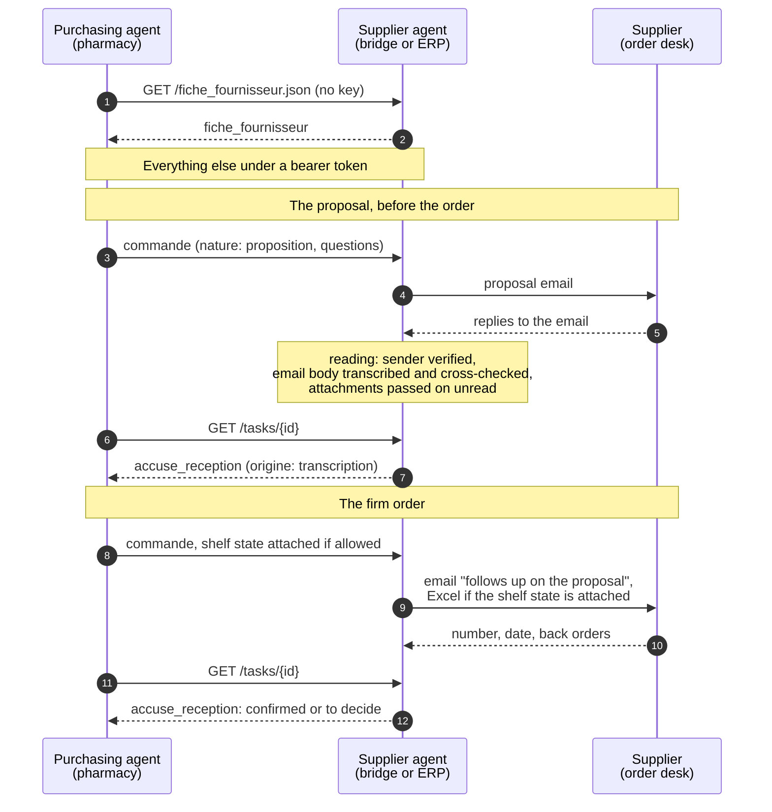
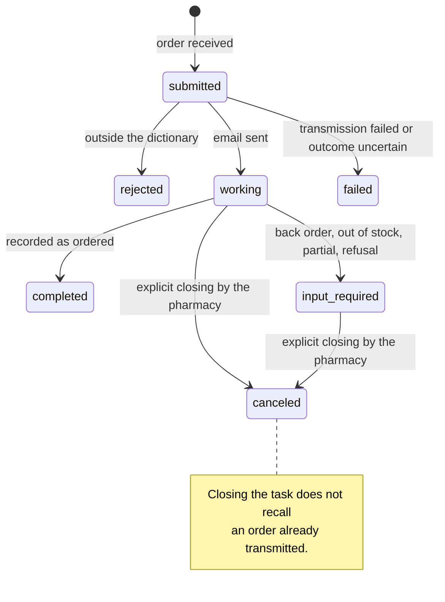

<!-- This guide has a French version, docs/guide-fr.md: every change goes into both. tests/test_guides.py checks that they stay twins. -->
# PharmA2A, the guide

[Back to the README](../README.md) · [Specification](../SPECIFICATION.md) · [Decision records](adr/README.md) · [Version française](guide-fr.md)

**The open protocol for direct orders between the pharmacy and its suppliers, laboratories, wholesalers and purchasing platforms, built on A2A.**

The dictionary (`schema/`) is in the public domain, CC0 1.0. The agent (`pharma2a/`) and
its tests (`tests/`) are licensed under Apache 2.0. Each folder carries its own LICENSE file.
Version 0.1, published on 12 November 2026.

This document is for the IT staff of suppliers and of pharmacy software vendors.

PharmA2A defines what a pharmacy's purchasing agent and a supplier's agent say to each other:
the supplier's sheet, an order, a reply to that order, a reminder if the
delivery is late, and, if the pharmacist decides so, the state of their shelf. This repository contains the dictionary of these messages and a
ready-to-use supplier agent that speaks it.

## The vision

Today, a direct order to a supplier takes the pharmacist's time: they count
the shelf, fill in an order form, send it to the sales rep (*délégué*), wait for a reply that comes by email or
by phone, then check the delivery. The supplier only sees the demand at the
moment the order lands.

Tomorrow, the pharmacy's purchasing agent prepares each order from the real shelf,
sends it once the pharmacist has said yes, and reads the reply. On the other side, the supplier's agent
receives it, passes it to its order desk and sends back what it confirms, what it
changes and when it delivers. The two speak PharmA2A to each other. Orders arrive right
the first time, discrepancies surface on their own, and the supplier sees, when the pharmacist
agrees, the shelf state of its products. It delivers according to real demand instead of
guessing it, as large retail has done with its suppliers for twenty years.

The pharmacist stays in control of their data and of their relationship with each supplier. Nothing
leaves without their action, none of their prices circulates, and they stop the sharing whenever they want.
No supplier money funds the pharmacy's agent.

## The words

| Word | What it means here |
|---|---|
| **Agent** | Software that acts on someone's behalf: it prepares, sends, reads and follows up, instead of only displaying. |
| **A2A** | Agent2Agent, the open protocol that lets two agents talk to each other, published under the umbrella of the Linux Foundation. It is the pipe; it knows nothing about pharmacy. |
| **PharmA2A** | The open protocol for the pharmacy and supplier exchange, built on A2A. A2A defines how we talk, PharmA2A defines what we say. |
| **Supplier** | Anyone who receives a direct order from the pharmacy: a laboratory, a wholesaler, a purchasing platform. The dictionary says `fiche_fournisseur` and `fournisseur`; only `numero_commande_labo`, in the acknowledgement, keeps the name from the first version, written for laboratories. |
| **The dictionary** | The exact shape of each message, in JSON Schema, field by field, in French. It is in the public domain. |
| **Pharmacy purchasing agent** | The agent that prepares and sends the pharmacy's orders, for example the one SyderaAI runs for its pharmacies. Any vendor can write its own. |
| **Supplier agent** | The agent that receives PharmA2A orders for a supplier. The one in this repository is given as open source; it is not sold. |
| **The supplier sheet** | The front desk: who the supplier is, how to reach it, its general terms, its range by CIP 13 with pack size (*colisage*) and status, and, if it wishes, its catalogue price list. It can be read without a key, by any agent, like a shop window; the price list only if the supplier makes it public. Never a discount specific to one pharmacy. |
| **The order** | The pharmacy's message: the products by CIP 13 code, the quantities, the reference. Never a price: the pharmacy says nothing about its prices. |
| **The acknowledgement** | The supplier's reply: confirmed quantities, back orders (*reliquats*), out-of-stock items (*ruptures*), substitutions, order number, delivery date, and, if it gives them, its list price, its discount and its net price, line by line. |
| **The shelf state** | For the supplier's references only: the stock, the sales of the last three months, the coverage and the months that ended at zero. It is only sent if the pharmacist has decided so for that supplier. |
| **Out of stock** (*rupture*) | The supplier cannot deliver. A stock at zero at the pharmacy is not out of stock; it is "at zero". |
| **The bridge** | The supplier agent hosted by the pharmacy's purchasing agent, as long as the supplier does not have its own. It writes to the order desk or the sales rep by email and reads the reply. |
| **The sales rep** | The supplier's salesperson who looks after the pharmacy. With the bridge, it is often the one who receives the email. |

## How we get from today to tomorrow

1. **Today, the bridge.** No supplier has an agent yet. The pharmacy's purchasing agent
   runs the one in this repository for each supplier. The supplier receives
   a clear email, the order in the body of the email (and an Excel file ready to key in when the shelf
   state comes with it), and replies as usual. Nothing is
   asked of it.
2. **Tomorrow, the supplier agent.** A supplier that wants clean orders and
   visibility on its pharmacies' shelves runs this agent itself, or its own,
   connected to its order system. The pharmacy changes one address; nothing else
   moves on its side.
3. **Then, common use.** Each pharmacy and each supplier that speaks PharmA2A
   makes the line more useful for all the others.

## What this repository contains

| Folder | Contents | Licence |
|---|---|---|
| `schema/` | The dictionary: `fiche_fournisseur.json`, `commande.json`, `accuse_reception.json`, `etat_de_rayon.json`, `relance.json`, and an example of each | CC0 1.0, public domain |
| `pharma2a/` | The supplier agent, in Python, on the official `a2a-sdk` SDK | Apache 2.0 |
| `tests/` | The tests for the dictionary and the agent | Apache 2.0 |

The agent depends on no vendor and contains no address and no secret.

### What is not in it

The repository says how we talk, not to whom or for whom. It contains no pharmacy
purchasing agent, no directory of agents in service, no key, and no data from a pharmacy or a
supplier: the names and codes in the examples are fictitious.

The invoice goes through the approved e-invoicing platforms. The supplier
copies the `reference` of the PharmA2A order into the order reference field of its
invoice, and the `id_ligne` into the order line reference field.

## For the supplier's IT staff

### The messages

| Message | Direction | A2A skill | Where it travels |
|---|---|---|---|
| `fiche_fournisseur` | supplier to all | `fiche`, or `GET /fiche_fournisseur.json` without a key | data artifact, or the document itself |
| `commande` | pharmacy to supplier | `commander` | data part of the sent message |
| `accuse_reception` | supplier to pharmacy | reply to `commander` | data artifact attached to the task |
| `etat_de_rayon` | pharmacy to supplier | `etat_de_rayon`, or inside the order | data part of the sent message |
| `relance` | pharmacy to supplier | `relancer` | data part of the sent message |






Six rules that are not up for debate:

1. **No pharmacy price in any message.** What belongs to the pharmacy never
   leaves: not its weighted average purchase price, not its selling price, not its margin, not the amount of its
   order, not its terms with another supplier, not its purchasing channel (buying group,
   retrocession), not any calculation that mixes its figures with the supplier's. What belongs
   to the supplier circulates as the supplier gives it, never recalculated: its catalogue price list in its
   sheet, and in its acknowledgement, line by line, its list price, the discount it
   grants this pharmacy and the net price it will invoice. The order itself carries
   no price: invoicing follows the terms in force between the pharmacy and the
   supplier. The free-shipping threshold (*franco*) is a supplier
   term: it appears in a message issued by the supplier (`conditions` of
   the acknowledgement). The pharmacy may repeat it as is in its order
   (`franco_ht`), only when its agent has checked that the order reaches it, and without
   ever stating the order amount. Likewise the pack size of a line (`colisage`), as
   the supplier gave it. The supplier thus sees at a glance that the order
   was placed correctly, without having to point it out. The schemas reject any unplanned field.
2. **Nothing invented.** A field that nobody stated stays `null`. The agent never fills in
   a delivery date, a quantity or an order number.
3. **Only the supplier speaks for the supplier.** The sheet and the acknowledgement
   are its messages, never the pharmacy's. A reply is only read if it comes
   from an address in the domain the order was sent to, and never if the
   mailbox says its sender failed authentication (DKIM, SPF, DMARC; only
   the header from the trusted receiving server counts, `PHARMA2A_IMAP_AUTHSERV`, and
   `PHARMA2A_EXIGER_AUTHENTIFICATION` discards what the mailbox did not verify; it is
   off by default for a first trial, and recommended in service: the address
   claimed by an email does not, on its own, prove who sent it). A
   forward, a copy or a message sent from the pharmacy itself never counts as a
   reply, even if it carries the order reference. An acknowledgement must answer the
   order it names: same reference, id_ligne values that exist in the order and are not
   repeated, codes that are those of the designated line and nothing more; otherwise it
   is discarded. A
   sheet contains only what the supplier said itself, in its price list, its
   terms or its sales rep's reply.
4. **A message that says nothing is not a confirmation.** With no line, no order
   number, no delivery date and no term, the reply is ignored and the task
   stays in progress.
5. **The pharmacy calls, the supplier answers.** No incoming notification, no
   stream. The pharmacy reads the task again whenever it wants.
6. **No patient data.** No name, no prescription, no social security number. The
   protocol talks about products, quantities and stock, never about people.

**An order is transmitted only once.** The reference (`reference`) is
the identity of the order, unique per pharmacy. The same reference received a second time
from the same pharmacy (same customer account, same CIP, or same name at the same address), for
example when the pharmacy's agent resends after a network outage, returns the task already
open, same identifier, same state, and nothing goes out again. A retransmission must never produce a second commercial order. The
proposal and the order that follows it share the reference but not the nature: they
are two tasks. A rejected, failed or canceled task transmitted nothing: its reference
may come back; after a closing by the pharmacy, the email says it cancels and replaces
the previous sending under this reference; after a channel failure, where it is unknown whether
the email went out, it says that if that email arrived, this one replaces it; the firm order
that follows a proposal says it follows up on it. The same reference with different
content (products, quantities, pack sizes, delivery address, required date, back order
accepted) while the task is still open is not a repetition: it is rejected, with the action to take (close the task, then resend).
This way a reminder or a correction is never silently left unsent. A message posted on a task that is already open, with
its identifier, transmits nothing either: the task stays in its state and says so.
One line per product: the same code (CIP, EAN or reference) on two lines is rejected.
Each line carries an `id_ligne`, unique within the order, and the acknowledgement answers
line by line with this identifier.

**Field names are in French, on purpose.** The dictionary describes the French
pharmacy (CIP 13, franco, reliquat, colisage), and translating its words would blur them.

### `fiche_fournisseur`: the supplier's front desk

Before any order, an agent wants to know who it is talking to: the sheet says so. Who the
supplier is, the order desk and the sales reps by département, the free-shipping threshold and on which
basis it is counted, the lead time, the shipping days, and the range: each reference sold
direct with its pack size and its status (`actif`, `nouveau`, `arrete` with the replacing
reference, `sur_commande` with its lead time). As in the order, a reference carries its
`cip13`, its `ean13` or its `ref_fournisseur`, at least one of the three. The supplier may
publish its **catalogue price list** there: the unit price excluding VAT before discount (`prix_tarif_ht`) on
each line, dated in `tarif`, the same for all pharmacies, with the VAT rate of
the reference (`taux_tva`), which the shop window shows even without the price list. Never a discount or a
price specific to one pharmacy. The full version of the price list and the general terms of
sale remain documents, referenced by their address in `documents`.

The sheet can be read **without a key**, at `GET /fiche_fournisseur.json` next to the card: it is
a shop window, any agent can consult it, even that of a pharmacy that is not
yet a customer. Over A2A, a message carrying `{"version": "1", "demande": "fiche_fournisseur"}`
returns it as an artifact. Without a key, the shop window does not show the price list (neither the block,
nor the product prices, nor the document of nature `tarif`), unless the supplier makes it public
(`PHARMA2A_FICHE_TARIF_PUBLIC=1`); the authenticated pharmacy always receives it. A sheet that does
not conform is not served: the shop window answers 503 without the detail, which stays in the log.
A term specific to one pharmacy (its discount) never goes into it: it travels in
the acknowledgement, under a key.

```json
{
  "version": "1",
  "fournisseur": { "nom": "LABORATOIRE EXEMPLE", "siren": "000000000", "site": "https://www.laboratoire-exemple.example", "marques": ["EXEMPLE"] },
  "date": "2026-10-30",
  "contacts": {
    "commandes": { "email": "commandes@laboratoire-exemple.example", "telephone": "01 00 00 00 00", "horaires": "du lundi au vendredi, 9 h à 17 h" },
    "delegues": [ { "secteur": ["75", "92", "94"], "email": "secteur-ouest@laboratoire-exemple.example", "telephone": "06 00 00 00 00" } ]
  },
  "conditions": { "franco_ht": 400, "assiette_franco": "net_remise", "delai_livraison_jours": 3, "jours_expedition": ["mardi", "jeudi"], "commande_directe": true, "par_grossiste": true },
  "tarif": { "date": "2026-01-01", "devise": "EUR" },
  "gamme": [
    { "cip13": "3400000000011", "libelle": "PROBIOTIQUE 7 SOUCHES STICKS 30", "colisage": 6, "prix_tarif_ht": 9.90, "taux_tva": 5.5, "statut": "actif" },
    { "cip13": "3400000000035", "libelle": "EQUILIBRE FEMININ GELULES 15", "statut": "arrete", "date_arret": "2026-10-01", "cip13_remplace_par": "3400000000042" },
    { "cip13": "3400000000059", "libelle": "CHEVEUX ET ONGLES GELULES 60", "statut": "sur_commande", "delai_jours": 15 }
  ],
  "documents": [ { "nature": "tarif", "url": "https://www.laboratoire-exemple.example/pro/tarif-2026.pdf", "date": "2026-01-01" } ]
}
```

The basis of the free-shipping threshold is stated or stays `null`: a threshold given without a basis allows
the pharmacy's agent to deduce nothing. The sheet is a supplier message (rule 3):
with the bridge, it only repeats what the supplier said, its price list, its terms,
its sales rep's replies, transcribed without adding anything; nothing in it comes from the pharmacy.
The day the supplier runs its own agent, it publishes its own.

### `commande`: what the supplier receives

An order form: the pharmacy, a reference, a date, lines. Each line carries its
`id_ligne`, the product code, an indicative label and a quantity in sales units. The
code is first the CIP 13; some over-the-counter health and beauty products do not have one, and the line then carries
its `ean13` or its `ref_fournisseur`, at least one of the three. The optional field
`agent` says which agent is writing and which pharmacist approved. The optional field
`etat_de_rayon` attaches the shelf state to the order, for a single sending.

Two optional fields say what the pharmacy expects from the reply:

- `date_livraison_exigee`: when `true`, a confirmation without a firm delivery date is not
  one; the pharmacist decides;
- `reliquat_accepte`: when `true`, what does not ship right away may follow as a back order
  without a new order, and a back order asks nothing of the pharmacist; when `false`, what
  does not ship is canceled. A line may say something different from the order; its own
  `reliquat_accepte` takes precedence. Absent: the pharmacy said nothing, and a back order is decided case by case.

The bridge's email tells the supplier in plain words, below the table.

```json
{
  "version": "1",
  "reference": "BC-26018-EXEMPLE",
  "date": "2026-10-15",
  "officine": {
    "nom": "Pharmacie de l'Exemple",
    "numero_compte_client": "123456",
    "cip_officine": "2000001",
    "telephone": "02 00 00 00 00",
    "adresse_livraison": { "ligne1": "1 rue de la Pharmacie", "ligne2": null, "code_postal": "75001", "ville": "Paris", "pays": "FR" }
  },
  "lignes": [
    { "id_ligne": "1", "cip13": "3400000000011", "libelle": "PROBIOTIQUE 7 SOUCHES STICKS 30", "quantite": 6 },
    { "id_ligne": "2", "cip13": "3400000000028", "libelle": "PROBIOTIQUE DIGESTION GELULES 20", "quantite": 21 },
    { "id_ligne": "3", "ean13": "3600000000017", "libelle": "BROSSE A DENTS SOUPLE", "quantite": 12 }
  ],
  "message": null,
  "agent": { "nom": "Agent Exemple", "signataire": "Dr Exemple" }
}
```

### The proposal: the order before the order

When the pharmacy's agent does not yet know the supplier's terms, it first sends
its order as a **proposal** (`"nature": "proposition"`), with its
**questions** (`"questions": ["franco", "colisage", "delai_livraison", "catalogue"]`). The
supplier does not ship it: it confirms it and replies. The agent corrects the order with the
reply, the pharmacist approves it, and the final order then goes out, under the same
reference. The bridge's email says so in plain words and lists the questions.

### `accuse_reception`: what the supplier sends back

The reply line by line, each line matched by its `id_ligne`: confirmed quantity,
back order, out of stock, proposed substitution, comment, and the supplier's terms for
this pharmacy if it gives them: its list price (`prix_tarif_ht`), its discount (`remise_pct`), the
net price it will invoice (`prix_net_ht`) and the VAT rate (`taux_tva`), each as the supplier writes it, never calculated from
the others. A discount valid for the whole order is stated once, at the level of
the acknowledgement (`remise_pct`); a line's discount prevails. The discount is the one shown on the
invoice: a year-end rebate or a back-end agreement is not included. Plus the number given to the order and the planned delivery date. A net price
that changes in a second email goes back to the pharmacist. And where the acknowledgement comes from, `origine`: `erp` when a
supplier system produced it, `transcription` when an agent read a human reply (an email, a
PDF) and transcribed it. A transcription can be wrong: the pharmacy's agent must
never take it as an automatic confirmation; it goes up to the pharmacist.

```json
{
  "version": "1",
  "reference": "BC-26018-EXEMPLE",
  "origine": "erp",
  "numero_commande_labo": "SO-884512",
  "date_livraison_prevue": "2026-10-20",
  "lignes": [
    { "id_ligne": "1", "cip13": "3400000000011", "quantite_confirmee": 6, "prix_tarif_ht": 9.90, "remise_pct": 30, "prix_net_ht": 6.93, "taux_tva": 5.5, "reliquat": 0, "rupture": false, "cip13_substitue": null, "commentaire": null },
    { "id_ligne": "2", "cip13": "3400000000028", "quantite_confirmee": 12, "prix_tarif_ht": 7.50, "remise_pct": 30, "prix_net_ht": 5.25, "taux_tva": 5.5, "reliquat": 9, "rupture": false, "cip13_substitue": null, "commentaire": "9 en reliquat, départ semaine 44" },
    { "id_ligne": "3", "ean13": "3600000000017", "quantite_confirmee": 0, "rupture": true, "commentaire": "rupture fabricant, retour prévu en décembre" }
  ],
  "commentaire": "Commande enregistrée le 15/10, départ le 17/10."
}
```

Two fields answer a proposal: `colisage` on each line, when the supplier
sells in multiples, and `conditions` for the whole order (`franco_ht`,
`delai_livraison_jours`, `catalogue_joint`). A catalogue attached to the email is passed on as is in
the task's `pieces_jointes` artifact.

If everything is confirmed as ordered, the task is completed. If there is a back order, an
out-of-stock item, a substitution or a changed quantity, the task moves to `input-required` and
the pharmacist decides. A firm order answered without a confirmation, with only a pack size,
a term or a catalogue, also moves to `input-required`: the supplier has
spoken, it has not confirmed. Likewise a partial reply: without an order number or a delivery
date, one confirmed line does not confirm the others, which remain unknown. An
order number or a delivery date, on the other hand, says that the supplier has recorded the
order: the lines it does not comment on are deemed as ordered; it only
lists the exceptions, as on any acknowledgement. The supplier may also
say it explicitly: `confirmation_globale` set to `true` ("order confirmed as
is"), or set to `false` if it does not take the order, and the pharmacist decides. A
back order of zero on its own answers nothing. For
a proposal, this same reply is the one expected, and the task is completed.
Nothing is accepted automatically.

**The supplier may write a second time.** An answered task keeps listening for
30 days: a new email about the same order is read with the same checks. If it
changes something (an out-of-stock item, a quantity, a postponed delivery date, a refusal,
a net price or a discount),
the pharmacist decides (`input-required`); if it only completes (a date or a number
that were missing), the state stays; if it says nothing new, nothing moves. A task in
`input-required` receives the new `accuse_reception` after the first one. Each email is
compared with everything the previous ones said (the date from the first, the number from the second), and
the same email is never processed twice. A
`completed` task never reopens, as A2A requires: the bridge opens a **follow-up task**
in the same `contextId`, which names the first one (`suite_de` metadata, and
`referenceTaskIds` in its first message), carries the new acknowledgement and listens in its place.
The pharmacy's agent follows the chain and reads the latest acknowledgement. A task closed by
the pharmacy no longer listens, and a closed follow-up closes the whole thread.

`input-required` is the bridge's last word on this exchange, in version 0.1: the pharmacist
decides in their own agent, and replies to the supplier by email, by phone or with a
new order under a new reference. A message posted on the task transmits
nothing. The pharmacy closes the task once it has decided (`tasks/{id}:cancel`); closing does not
recall an email already sent.

### `relance`: when delivery is late or the reply is missing

The pharmacy sends a reminder for an order already transmitted, under the same reference. Two reasons:
`livraison_en_retard` (with `date_livraison_annoncee`, the date the supplier had
given) and `sans_reponse`. The agent finds the order it received under this reference
for the same pharmacy, and rejects the reminder if it finds none. Only one reminder per
reason per day.

The bridge writes to the supplier in the order's thread (`In-Reply-To`), repeats the
reference, the announced date and the ordered lines, and asks where the order stands. A
reminder never places a new order and never changes the products or the quantities.
The supplier's reply comes back on the reminder's task, as an `accuse_reception`, with
the same checks as a reply to the order: the new delivery date, an
out-of-stock item, a refusal.

```json
{
  "version": "1",
  "reference": "BC-26018-EXEMPLE",
  "date": "2026-11-02",
  "officine": { "nom": "Pharmacie de l'Exemple", "numero_compte_client": "123456", "adresse_livraison": { "ligne1": "1 rue de la Pharmacie", "ligne2": null, "code_postal": "75001", "ville": "Paris", "pays": "FR" } },
  "motif": "livraison_en_retard",
  "date_livraison_annoncee": "2026-10-30",
  "message": null
}
```

### `etat_de_rayon`: what the supplier receives, if the pharmacist decided so

The pharmacist turns on sharing supplier by supplier, on that supplier's
references only, and turns it off whenever they want. No price, no margin, no
revenue, no reference from another supplier, no patient data. The agent rejects
a shelf state that is not that of the ordering pharmacy, or that names
a supplier other than its own.

```json
{
  "version": "1",
  "officine": { "nom": "Pharmacie de l'Exemple", "numero_compte_client": "123456", "cip_officine": "2000001" },
  "fournisseur": "LABO UN",
  "date": "2026-10-15",
  "periode": { "du": "2026-07-01", "au": "2026-09-30" },
  "lignes": [
    { "cip13": "3400000000011", "libelle": "PROBIOTIQUE 7 SOUCHES STICKS 30", "stock": 0, "ventes_3_mois": 2, "couverture_jours": 0, "mois_a_zero_3_mois": 1 },
    { "cip13": "3400000000028", "libelle": "PROBIOTIQUE DIGESTION GELULES 20", "stock": 3, "ventes_3_mois": 12, "couverture_jours": 23, "mois_a_zero_3_mois": 0 },
    { "cip13": "3400000000059", "libelle": "CHEVEUX ET ONGLES GELULES 60", "stock": 0, "ventes_3_mois": 0, "couverture_jours": null, "mois_a_zero_3_mois": 3 }
  ]
}
```

We count months that ended at zero, not days, because the pharmacy's software does not
keep the daily history of its stock. A count of days would be invented.

The optional field `accord` says what the pharmacist allows: `usage` set to `livraison`
(only to deliver this pharmacy better) or `previsions` (also for the supplier's overall
forecasts, without ever handing over the data), `valable_jusqu_au` (a date,
or `null` until they withdraw it), `frequence` (`commande`, `quotidienne`,
`hebdomadaire`, `mensuelle`). Without `accord`, the supplier sticks to delivering better.

## The bridge in practice

When the agent runs as a bridge, it writes to the supplier by email.

- **One email per order.** The order table is in the body of the email, with
  the stock and sales of each line when the shelf state is shared. In that case, an
  Excel file is attached, with a "Commande" tab ready to key in and an "État de
  rayon" tab.
- **The email introduces itself.** It says which agent is writing, for which pharmacy, and which
  pharmacist approved. It carries an `X-PharmA2A-Reference` header.
- **The reply comes back on its own.** The sales rep replies to the email as usual. The agent reads
  the reply mailbox at regular intervals. An email that does not come from the domain of the
  order's recipient is discarded before any reading (rule 3). The others are
  transcribed into `accuse_reception`, with `origine` set to `transcription`,
  by a language model that has no tools and only receives the text between quotes;
  the agent validates the result against the dictionary and attaches it to the task. What is not
  written in the reply stays `null`. If the transcription does not respect the dictionary,
  or if it says nothing about the order (rule 4), the task stays in progress and nothing is
  invented. An email is only marked as read once processed or discarded for good: if the model
  is unreachable, the reply waits in the mailbox for the next pass. The reply finds
  its order first by the `Message-ID` of the sent email, which it cites in its
  `In-Reply-To` (then in its `References` thread), otherwise by the reference in the subject or the
  text, among the orders in progress whose sender is the supplier. A reply that
  cites a sending whose task is closed answers that sending: it is discarded; it does not
  attach to the next one under the same reference. Two tasks in progress that could both
  receive it make a reply ambiguous: it waits too.
- **What the model sees.** Transcription is the only step that leaves the agent. The
  model's provider (`PHARMA2A_MODELE`) receives the text of the sales rep's reply and, to
  match it, the order's reference and lines (product codes, labels, quantities). The agent
  never adds the pharmacy's identity (name, account, address), the mailbox, the other orders,
  or any price: the order carries none. What the sales rep wrote in the reply goes as written. Without a configured model nothing leaves: replies wait
  in the mailbox, to be transcribed another way (through an ERP, or by hand).
- **Draft by default.** As long as `PHARMA2A_BROUILLON` is 1, nothing goes out: each
  email is written to the `sorties/` folder to be reviewed.

## The protocol

- **A2A 1.0** (text 1.0.1), HTTP+JSON binding (`POST /message:send`, `GET /tasks/{id}`) and
  JSON-RPC on the same root. Both are declared in the card. The header
  `A2A-Version: 1.0` is expected: the version is compared on major and minor (`1.0.1` passes,
  `1.1` or `1.999` are rejected with `VersionNotSupportedError`).
- **The task list** (`GET /tasks`) only returns, counts and paginates the tasks of the
  token's account: `totalSize` says nothing about other pharmacies.
- **Agent card** at `/.well-known/agent-card.json`: name, description, supplier
  address (`provider.url`), interfaces, security and skills, all public, as the
  A2A 1.0 text requires. The extended card, identical, is still served to authenticated
  clients.
- **Authentication** by bearer token, which the supplier issues to each pharmacy and
  binds to its customer account number (see [Pharmacy tokens](#pharmacy-tokens)).
- **Capabilities**: `streaming: false`, `pushNotifications: false`. A stream request receives
  `UnsupportedOperationError`.
- **Extension**: PharmA2A declares itself in the card as an A2A profile extension
  (`capabilities.extensions`, address `https://pharma2a.org/ext/v1`, version 1 of the
  dictionary; a breaking change will get a new address). It is optional
  (`required: false`): a client that does not request it through the `A2A-Extensions` header is
  served the same, since every message is validated against the dictionary anyway. The
  artifacts that carry a dictionary message (acknowledgement, sheet) cite it in their
  `extensions`.
- **Order lifecycle**: `submitted` on receipt and validation, `working` when
  the order has gone out to the supplier, `completed` with the acknowledgement as an artifact when
  the reply confirms everything, `input-required` when the pharmacist must decide, `rejected`
  when the message does not respect the dictionary, with the reason in the status message.
  A send returns once the agent has finished its turn, with the order gone out, in `working`:
  the supplier's reply comes hours or days later, and the pharmacy reads the
  task again. `returnImmediately` returns the task as soon as it is created. An order resent
  identically returns the task already open, with the requested `historyLength` limit.
- **Known deviation from A2A.** With `returnImmediately` set to `false` (the default), the
  text requires waiting for a terminal or interrupted state before replying. An order only
  reaches one when the supplier replies, sometimes days later: no connection
  stays open that long. The bridge therefore replies as soon as the order has gone out, in
  `working`, and says so in the status message. The client reads the task again (`GET /tasks/{id}`)
  or sends `returnImmediately: true`.
- **One process per store**: a store's tasks are served by a single process,
  which holds the idempotency lock. Several agents means the directory, not several
  processes on the same file.
- **Integers**: the A2A transport may return an integer as a float, `6` becomes `6.0`. The
  schemas accept `6.0` for an integer, and the agent normalises it again before writing.

## Plugging in your own system

The agent talks to the supplier through a channel (backend), chosen by `PHARMA2A_BACKEND`. The
`mail` channel is provided. A supplier that plugs in its ERP writes `pharma2a/backends/erp.py`, a
`Backend(config)` class that exposes exactly:

- `origine = "erp"`: its acknowledgements come from its system, not from a reading (the
  mail channel always says `transcription`);
- `transmettre(message, doc, reference, message_id) -> str`: receives the document already
  validated by the agent (`"commande"`, with its shelf state if attached,
  `"etat_de_rayon"` or `"relance"`) with the unique identifier of this sending, and returns the
  number the ERP gives it;
- `lire_reponses(depuis=None) -> list[Reponse]`: each `Reponse` carries `accuse`,
  the dictionary acknowledgement, line by line with the order's `id_ligne`,
  `reference`, and `en_reponse_a=[message_id]`, the sending it answers: two pharmacies
  may have the same reference, and without it their acknowledgements stay ambiguous; reading
  marks nothing;
- `acquitter(identifiants)`: these replies have been processed.

The agent validates each acknowledgement against the schema and cross-checks it with the order; no model
reads it. `pharma2a/backends/erp_exemple.py` is a working reference channel,
exchanging JSON files through two folders, one file per sending, the reply citing
the sending it answers (`{"en_reponse_a": "<message_id>", "accuse": {...}}`): copy
it to `erp.py`, replace its three methods with the ERP's calls, set `PHARMA2A_BACKEND=erp`. A supplier may also
write its agent from scratch, in the language of its choice: it only needs to speak A2A 1.0 and
the dictionary.

### Try it with an ERP in ten minutes

The reference ERP channel exchanges JSON files through two folders: enough to see
the full round trip before writing a line of code. The commands are those of the
English section [Try it with an ERP in 10 minutes](erp.md#try-it-with-an-erp-in-10-minutes), to
run from the repository root, in two terminals:

1. the agent, with `PHARMA2A_BACKEND=erp_exemple` and a sqlite store (`PHARMA2A_BASE`);
2. the demo pharmacy (`python -m pharma2a.officine --attendre 3`) sends the example
   order: the task is in `working`, and the validated order is in
   `erp/sortie/commande-<message_id>.json`; this is what the ERP reads. The same order tries
   any supplier agent: `--agent <adresse> --jeton <jeton>`;
3. the ERP replies: the example acknowledgement dropped into `erp/entree/`, with `en_reponse_a`, the sending
   it answers; `python -m pharma2a --relire` runs a reading pass right away;
4. `python -m pharma2a.officine --tache <id>` reads the task again: it moves to `input-required` (a back order and an out-of-stock item), with the acknowledgement as an
   artifact and the supplier's order number; an acknowledgement that confirms everything completes the
   task (`completed`).

Then, plug in your ERP: copy `erp_exemple.py` to `erp.py`, set
`PHARMA2A_BACKEND=erp`, replace the three methods with the ERP's calls. With an ERP that
has an API (Odoo, SAP, Sage X3...): `transmettre` creates the sales order and returns its number,
`lire_reponses` returns the orders confirmed by the team as acknowledgements that cite
the sending they answer, `acquitter` marks them as passed on. The agent keeps all the
rest: A2A, the tokens, validation, idempotency, the task lifecycle.

#### The dictionary against an ERP's fields

What each field usually is in an ERP. The pharmacy never sends prices; the
supplier's prices, if it gives them, come back in the acknowledgement. The detail is in the tables of the
English section [Mapping the dictionary to an ERP](erp.md#mapping-the-dictionary-to-an-erp); in
short:

- **The customer**: `officine.numero_compte_client`, its account with the supplier; failing that
  (null), the pharmacy's CIP, its name and its address.
- **The item**: `cip13` or `ean13`, usually the barcode on the item record,
  `ref_fournisseur` the internal reference; the label is only indicative.
- **The references**: `reference` and `id_ligne` are kept on the sales order and
  come back on the acknowledgement and on the invoice.
- **The quantities**: in sales units, never in cases. In the acknowledgement,
  `quantite_confirmee` ships now, `reliquat` ships later, `rupture` does not ship.
- **The supplier's prices**: its list price, the discount shown on the invoice, the net price and the
  VAT, as it will invoice them; the agent never calculates them.

## Installing and configuring

Python 3.11 or later. On a clean machine, in draft mode:

```bash
python3 -m venv .venv && . .venv/bin/activate
pip install -e ".[modele,test]"
PHARMA2A_JETON=un-jeton-de-test python -m pharma2a
```

The agent answers at http://127.0.0.1:8765/.well-known/agent-card.json. Nothing goes out: the
emails are written to `sorties/`. `python -m pytest` checks the installation.

Everything goes through environment variables, listed in `.env.example`. None is
in the code. To keep them in a file, copy `.env.example` to `.env`, fill in what you need and
load it before starting the agent: `set -a; . ./.env; set +a`. A variable left empty counts
as absent.

| Variable | Role | Default |
|---|---|---|
| `PHARMA2A_JETONS` | the registry of pharmacy tokens, each bound to a customer account (see below) | |
| `PHARMA2A_JETON`, `PHARMA2A_COMPTE_CLIENT` | a single token, for an agent that serves only one pharmacy or for trials, and the account it is bound to; without an account, it is valid for any account. Never together with `PHARMA2A_JETONS`: the agent does not start, a token valid for any account would mix pharmacies | one of the two token settings is mandatory without a directory |
| `PHARMA2A_FOURNISSEUR` | the supplier's name in the card | Fournisseur |
| `PHARMA2A_URL` | the address announced in the card | http://127.0.0.1:8765 |
| `PHARMA2A_HOTE`, `PHARMA2A_PORT` | where to listen | 127.0.0.1, 8765 |
| `PHARMA2A_TOUT_PUBLIC` | 1: no extended card announced, the public card already says everything | 0 |
| `PHARMA2A_SITE` | the supplier's website, announced in the card (`provider.url`) | the agent's address |
| `PHARMA2A_BASE` | the SQLite file for tasks, empty to keep them in memory | |
| `PHARMA2A_BROUILLON` | 1: nothing goes out, everything is written to `sorties/` | 1 |
| `PHARMA2A_SORTIES` | the drafts folder | sorties |
| `PHARMA2A_BACKEND` | the channel, `mail` or a `backends/<nom>.py` module | mail |
| `PHARMA2A_ERP_SORTIE`, `PHARMA2A_ERP_ENTREE` | with the `erp_exemple` channel, the folder where the agent drops documents and the folder where the ERP drops acknowledgements | erp/sortie, erp/entree |
| `PHARMA2A_DESTINATAIRE`, `PHARMA2A_COPIE`, `PHARMA2A_EXPEDITEUR` | who receives at the supplier, who is in copy, who sends; several addresses separated by commas. A copy on a recipient's domain is a second supplier contact (a sales rep); a copy on another domain is the pharmacy, whose reply never counts as the supplier's | |
| `PHARMA2A_SMTP_HOTE`, `_PORT`, `_UTILISATEUR`, `_MOT_DE_PASSE` | sending by SMTP | port 587 |
| `PHARMA2A_GMAIL_COMPTE` | sending through the Gmail API from the sender's mailbox: the file of its authorisation (refresh token) or of a service account with delegation, which requires `pip install ".[gmail]"`. Takes priority | |
| `PHARMA2A_BREVO_CLE` | sending through the Brevo API, instead of SMTP | |
| `PHARMA2A_IMAP_HOTE`, `_PORT`, `_UTILISATEUR`, `_MOT_DE_PASSE`, `_DOSSIER` | the mailbox where replies arrive | port 993, INBOX |
| `PHARMA2A_IMAP_AUTHSERV` | the receiving server whose `Authentication-Results` headers (DKIM, SPF, DMARC) are trusted, e.g. `mx.google.com` for Gmail; empty: a failure in any header discards the reply, and no header counts as a positive verdict | |
| `PHARMA2A_EXIGER_AUTHENTIFICATION` | 1: a reply without an authentication verdict is discarded; requires `PHARMA2A_IMAP_AUTHSERV` | 0 |
| `PHARMA2A_RELECTURE_MINUTES` | the reading interval, 0 to read manually with `python -m pharma2a --relire` | 10 |
| `PHARMA2A_MODELE`, `PHARMA2A_MODELE_CLE` | the name of the model that transcribes replies and its key, through the Anthropic SDK; the name is mandatory as soon as there is a key, no default in the code | |
| `PHARMA2A_LOGO_PIED` | the address of an image for the email footer | |
| `PHARMA2A_FICHE` | the JSON file of the supplier sheet, served without a key at `/fiche_fournisseur.json` and reloaded when it changes; a sheet outside the dictionary is not served | |
| `PHARMA2A_FICHE_TARIF_PUBLIC` | 1: the keyless shop window also shows the catalogue price list; otherwise only the authenticated pharmacy receives it | 0 |
| `PHARMA2A_ANNUAIRE` | several agents in one process, see below | |

To check sending without an order: `python -m pharma2a --test-mail vous@officine.example`.

### Pharmacy tokens

The supplier issues a token to each customer pharmacy, bound to its customer account
number. The pharmacy presents it in the `Authorization: Bearer <jeton>` header. The agent
rejects:

- a request without a token, or with a token it does not know (401);
- an order whose `officine.numero_compte_client` is not the token's account (400);
- reading, listing or closing a task of another pharmacy (404, as if it
  did not exist).

The public card and the supplier sheet can be read without a token. Everything else, extended
card included, goes through the gate.

```bash
export PHARMA2A_JETONS=jetons.json
python -m pharma2a jeton creer --compte 123456 --nom "Pharmacie de l'Exemple"   # shows the token, only once
python -m pharma2a jeton lister                                                  # account, name, date, start of the fingerprint
python -m pharma2a jeton revoquer --compte 123456                                # all tokens for this account
python -m pharma2a jeton revoquer --empreinte sha256:3f9a                        # a single token
```

The registry keeps only the SHA-256 fingerprint of each token, never the token itself:
a lost token cannot be recovered; you create another one and revoke the old one. The file
is reloaded when it changes: a revoked token is rejected from the next request on, without
restarting the agent. The token is passed to the pharmacy through a secure channel, not in the order
email.

### Several agents in one process

A group with several brands, or a bridge that serves several pharmacies, runs a
single process with `PHARMA2A_ANNUAIRE`, a JSON file:

```json
{ "agents": [
  { "id": "labo-un", "fournisseur": "LABO UN", "jetons": "jetons/labo-un.json", "destinataire": "commandes@…", "copie": "delegue@…", "fiche": "fiches/labo-un.json" },
  { "id": "labo-deux", "fournisseur": "LABO DEUX", "jetons": "jetons/labo-deux.json", "destinataire": "commandes@…" }
] }
```

Each agent answers under its own path, for example `/labo-un/.well-known/agent-card.json`,
with its token registry, its recipient and its sheet (`/labo-un/fiche_fournisseur.json`). Sending, the task store and reading are
shared; tasks are not: each task carries the agent that received it, and an agent
only returns, cancels or lists its own. The file is reloaded when it changes: an
added agent is served without a restart.

## Tests and conformance

- `python -m pytest` from this folder: the dictionary, including the rejection of a price and of
  any unknown field, the agent end to end in draft mode, the sheet without a key and as an
  artifact, the reading of replies and the directory.
- **Official A2A conformance kit**, `a2aproject/a2a-tck` (commit `d4d6fae`), run against
  the agent in draft mode on both bindings: 101 passed, 154 not applicable (streaming,
  push notifications, gRPC, which the agent does not offer), 10 failed, all of them
  conversational agent scenarios that send free text and expect an agreed
  phrase or a demo artifact. This is intended: this agent only speaks the
  dictionary; it rejects free text and says so.
- **The content type is negotiated.** The A2A 1.0 text requires `application/json` on the
  HTTP+JSON binding (section 11.1); its examples and its registered media type say
  `application/a2a+json`. The agent answers `application/a2a+json` to a client that announces it in
  `Accept`, and `application/json` to the others.

## Evolving the protocol

The dictionary changes by versions, never silently: an added field is optional;
a removed field, or a field made mandatory, makes a new version. Proposals go
through this repository's issues. An implementation that calls itself PharmA2A speaks the dictionary
as published here, with no extra field.

PharmA2A is maintained by SyderaAI, Paris. See `CONTRIBUTING.md` (how to propose a change),
`SECURITY.md` (reporting a vulnerability), `CHANGELOG.md` (the versions) and `TRADEMARK.md` (the name).
