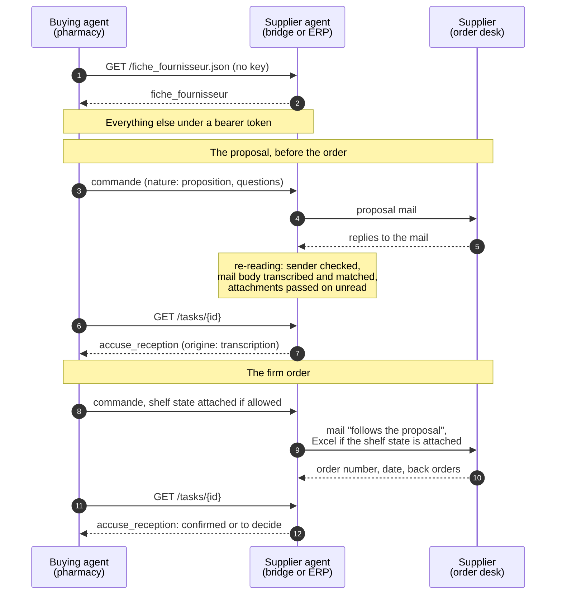
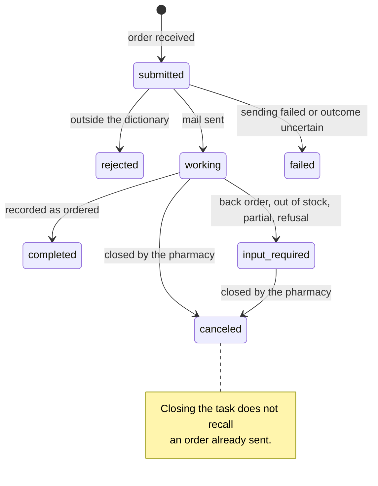

# The PharmA2A protocol in detail

[Back to the README](../README.md) · [Specification](../SPECIFICATION.md) · [Decision records](adr/README.md) · [The guide](guide.md) · [Guide en français](guide-fr.md)

## What the pharmacy and the supplier say to each other

In France, a community pharmacy orders directly from hundreds of suppliers (dermocosmetics,
supplements, medical devices). Every order is a form, a mail, a phone call, then a check at
delivery. The supplier only sees the demand when the order lands. PharmA2A fixes what the
pharmacy's buying agent and the supplier's agent say to each other, so that an order is right
the first time and the supplier learns, when the pharmacist allows it, what its products do on
the shelf.

A2A (Agent2Agent, Linux Foundation) is the pipe: it says how two agents talk. PharmA2A is
what they say: five messages, each a JSON Schema in French, in the public domain. This
repository holds the dictionary and a ready-to-run supplier agent that speaks it.

To our knowledge, this is the first sector-specific dictionary built on A2A. In A2A's own terms,
PharmA2A is a *profile extension*, declared in the agent card under
[`https://pharma2a.org/ext/v1`](https://pharma2a.org/ext/v1): every message is a data part that
follows one of the dictionary's schemas. The extension is optional in version 1, since the agent
validates every message anyway.

| Message | From | To | What it carries |
|---|---|---|---|
| `fiche_fournisseur` | supplier | anyone, no key | who the supplier is, how to reach it, its general terms (minimum for free shipping, lead time), its range by CIP 13 with pack size, status (active, new, discontinued, on request) and VAT rate, and, if the supplier chooses, its list price. Readable at `GET /fiche_fournisseur.json` next to the agent card; without a key the list price is shown only if the supplier makes it public. |
| `commande` | pharmacy | supplier | the purchase order: products by CIP 13, quantities, a reference. Sent first as a *proposal* with questions when the terms are unknown. |
| `accuse_reception` | supplier | pharmacy | line by line: confirmed quantity, back order, out of stock, substitution; the supplier's order number and delivery date; its list price, discount, net price and VAT rate, as it writes them; pack sizes and terms in answer to a proposal. |
| `etat_de_rayon` | pharmacy | supplier | only for the supplier's own products, only if the pharmacist turned it on: stock, three months of sales, cover, months ended at zero. |
| `relance` | pharmacy | supplier | a follow-up on an order already sent: the announced delivery has not arrived, or the order got no answer. Sent in the order's mail thread; it never places a new order. |

Six rules that do not bend:

1. **No pharmacy price in any message.** What belongs to the pharmacy never leaves: no average
   purchase price, no retail price, no margin, no order amount, no terms from another
   supplier, no purchase channel (central buying, retrocession). What belongs to the supplier
   travels as the supplier states it, never recomputed: its list price in its sheet, and in
   its acknowledgement, line by line, its list price, the discount it grants this pharmacy and
   the net price it will invoice. The order itself carries no price. The schemas reject any
   unknown field. The supplier's free-shipping threshold is
   the supplier's term, stated by the supplier; the pharmacy may quote it back, never compute it.
2. **Nothing invented.** A field nobody stated stays `null`. The agent never fills in a
   delivery date, a quantity or an order number.
3. **Only the supplier speaks for the supplier.** The supplier sheet and the acknowledgement are its
   messages. A reply is read only if it comes from the domain the order was sent to, and
   not if the mailbox says its sender failed authentication (DKIM, SPF, DMARC). An
   acknowledgement must answer the order it claims: same reference, line ids that exist.
4. **A message that says nothing is not a confirmation.**
5. **The pharmacy calls, the supplier answers.** No push, no stream. The pharmacy re-reads the task.
6. **No patient data.** No name, no prescription, no social security number. The protocol
   speaks of products, quantities and stock, never of people.

**An order is transmitted once.** The reference is the order's identity. The same
reference received again for the same customer account, as happens when a client retries
after a network error, returns the task already open, same id, same state, and nothing
leaves again. A retransmission must never produce a second commercial order. A message
sent to a task already open transmits nothing either. The same reference with different
content while the task is still open is refused, with the gesture to make (close the task,
then resend): a correction never silently fails to leave. A reference sent again after
the pharmacy closed its task is allowed, and the mail then says it cancels and replaces
the previous one. Each line carries an `id_ligne`, and the acknowledgement answers line by
line with it.

**Field names are in French, on purpose.** The dictionary describes French pharmacy
practice (CIP 13, franco, reliquat, colisage), and translating its words would blur them.
*Les noms de champs sont en français, c'est voulu : le dictionnaire décrit l'officine
française, et traduire ses mots les rendrait flous.*

**Invoices** go through the approved e-invoicing platforms. The supplier copies the
PharmA2A order `reference` into the order reference field of its invoice, and the
`id_ligne` into the order line reference field.

Some parapharmacy products have no CIP 13: a line carries a `cip13`, an `ean13` or a
`ref_fournisseur`, at least one of the three; the label is always there. The acknowledgement
says where it comes from, `origine`: `erp` when a supplier system produced it, `transcription`
when an agent read a human reply (a mail, a PDF). A transcribed acknowledgement should never
be accepted automatically by the pharmacy's agent: it goes to the pharmacist.

## Protocol and A2A conformance

- **A2A 1.0** (text 1.0.1), HTTP+JSON binding (`POST /message:send`, `GET /tasks/{id}`) and
  JSON-RPC on the same root, both declared in the agent card. The client sends
  `A2A-Version: 1.0`; the version is compared on major and minor (`1.0.1` passes, `1.1` is
  refused with `VersionNotSupportedError`).
- **Extension.** PharmA2A is declared as an A2A profile extension,
  [`https://pharma2a.org/ext/v1`](https://pharma2a.org/ext/v1), in `capabilities.extensions`,
  with `required: false`. Clients may ask for it with the `A2A-Extensions` header; artifacts
  that carry a dictionary message (acknowledgement, supplier sheet) list it in `extensions`.
- **Authentication.** Bearer token, one per pharmacy, bound to its customer account at the
  supplier. Only the agent card and the supplier sheet are public.
- **Capabilities.** `streaming: false`, `pushNotifications: false`. A streaming request gets
  `UnsupportedOperationError`.
- **Task lifecycle.** `submitted` on receipt, `working` once the order has left for the
  supplier, `completed` with the acknowledgement as an artifact when everything is
  confirmed, `input-required` when the pharmacist has to decide, `rejected` when the message
  does not follow the dictionary (the reason is in the status message). A terminal task is
  never reopened: a later answer from the supplier opens a follow-up task in the same
  `contextId`, which names the first one (`suite_de` metadata, `referenceTaskIds`).
- **Idempotence.** The order `reference` is the order's identity per customer account: the
  same reference sent again returns the task already open, honouring `historyLength`.
- **Task listing.** `GET /tasks` returns, counts and paginates only the tasks of the token's
  account.
- **Known deviation.** With `returnImmediately: false` (the default), A2A asks the server to
  wait for a terminal or interrupted state. An order only reaches one when the supplier
  answers, sometimes days later, and no connection lasts that long: the agent answers as soon
  as the order has left, in `working`, and says so in the status message. Clients re-read the
  task or send `returnImmediately: true`.
- **Content type.** `application/a2a+json` to clients that accept it, `application/json`
  otherwise. Integers that the protobuf transport turns into floats (`6.0`) are accepted for
  integer fields and normalised.

**Conformance.** Checked against the official A2A conformance kit
([`a2aproject/a2a-tck`](https://github.com/a2aproject/a2a-tck), commit `d4d6fae`) on both
bindings: 101 passed, 154 skipped (optional features the agent does not offer: streaming,
push notifications, gRPC), 10 failed. The 10 failures are free-text demo scenarios: the kit
sends plain text and expects a canned reply or a demo artifact. That is by design: this
agent only speaks the dictionary and refuses free text, saying so. To reproduce, start the
agent in draft mode and run the kit's `tests/compatibility/` suite with
`--sut-host=<agent URL> --transport=jsonrpc,http_json`.
